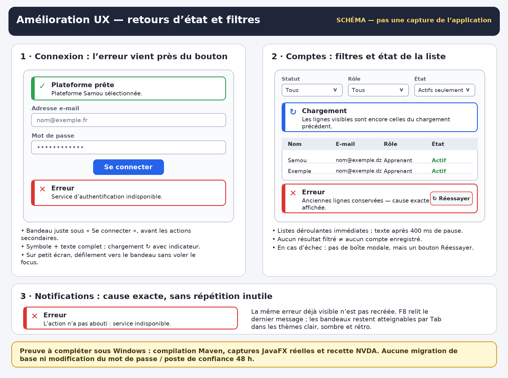

# Amélioration UX — retours d'état et filtres administrateur

Cette itération corrige les frictions observées pendant les essais Windows :
un message important pouvait se trouver tout en bas du formulaire de connexion,
la notification globale répétait un texte générique au lieu de la cause exacte,
et l'écran administrateur ne montrait ni chargement en cours ni caractère
périmé des lignes conservées après un échec d'actualisation.

Elle ne modifie ni l'authentification, ni le poste de confiance de 48 heures,
ni les rôles, ni le filtrage/pagination PostgreSQL côté serveur. Aucune
migration de base et aucun secret ne sont nécessaires.

> Le PNG est un **schéma explicatif**, pas une capture de l'application réelle.

## Écran de connexion

- L'état du formulaire devient un bandeau placé immédiatement sous le bouton
  principal, avant les actions secondaires « Créer un compte », « Activer mon
  compte » et « Oublier ce poste de confiance ».
- Chaque état combine un symbole, une bordure colorée et le texte complet :
  information `ℹ`, chargement `↻`, succès `✓`, point à vérifier `⚠`, erreur `✕`.
  La couleur n'est donc jamais le seul repère.
- Pendant une requête, un indicateur de chargement accompagne le message.
- Sur petit écran, les messages de chargement, de succès et d'erreur font
  défiler le formulaire jusqu'au bandeau sans déplacer le focus clavier.
- L'état de découverte réseau reçoit la même présentation : recherche,
  plateforme prête, choix à vérifier ou plateforme introuvable.
- Les anciennes notifications vagues du formulaire (« Vérifiez les champs… »,
  « Consultez les indications… ») sont remplacées par le message exact déjà
  affiché dans le bandeau.

## Notifications asynchrones

- `TaskRunner` transmet maintenant l'exception à la notification : elle affiche
  par exemple « L'action n'a pas abouti : Service d'authentification
  indisponible » au lieu du seul texte générique.
- Si un rafraîchissement automatique signale exactement la même erreur alors
  que son popup est déjà visible, le popup n'est pas recréé. Le dernier message
  reste relisible avec **F8**, comme auparavant.

## Comptes et rôles

- Les filtres par statut, rôle et état actif/inactif s'appliquent dès la
  sélection dans la liste déroulante.
- La recherche par nom/e-mail et le domaine s'appliquent après une pause de
  saisie de 400 ms ; Entrée et le bouton **Filtrer** les appliquent
  immédiatement.
- Si un critère change pendant une requête, le résultat périmé n'écrase pas
  l'écran : un second chargement part avec les critères les plus récents.
- Un bandeau au-dessus du tableau indique successivement :
  - le chargement, avec un indicateur ;
  - que les lignes visibles sont encore celles du chargement précédent ;
  - le nombre de résultats et la page lorsque la liste est à jour ;
  - l'absence de résultat pour les filtres, distincte de l'absence totale de
    compte ;
  - l'erreur exacte et un bouton **↻ Réessayer** en cas d'échec.
- Après un échec, l'ancienne liste n'ouvre plus une boîte modale
  « Actualisation impossible » : le bandeau précise explicitement que les lignes
  conservées proviennent du chargement précédent.
- La réinitialisation rétablit tous les critères en une seule fois puis lance
  un seul rechargement. La taille de page et les décisions par lot ne changent
  pas.

## Accessibilité

- Les deux bandeaux ont un texte accessible préfixé par leur nature, par
  exemple « Erreur : … » ou « Chargement : … ».
- Les messages restent atteignables au clavier ; le bouton **Réessayer** est un
  vrai bouton JavaFX avec un nom accessible complet.
- Le défilement automatique ne vole pas le focus. Les raccourcis existants
  **F6/Maj+F6** et **F8** sont inchangés.
- Les styles utilisent les jetons des thèmes clair, sombre et rétro.

## Recette Windows à effectuer

Les contrôles structurels ne prouvent ni la compilation Java, ni le rendu
JavaFX, ni l'annonce par NVDA.

1. Exécuter `.\mvnw.cmd clean test` dans le projet Windows.
2. Démarrer PC1 normalement, vérifier Docker/PostgreSQL et le service HTTPS,
   puis ouvrir un poste apprenant.
3. Sur une fenêtre réduite en hauteur, valider le formulaire avec des champs
   vides : le bandeau d'avertissement doit devenir visible sans recherche
   manuelle du bas du formulaire.
4. Vérifier une connexion normale : chargement, demande éventuelle du code
   e-mail et mot de passe toujours demandé à chaque ouverture.
5. En administrateur, choisir **Actifs seulement** sans cliquer sur
   **Filtrer** : la liste doit se recharger automatiquement. Saisir ensuite un
   domaine sans résultat, par exemple `aucun.test`, attendre la fin de la
   saisie et vérifier le message « Aucun compte ne correspond aux filtres ».
6. Cliquer sur **Réinitialiser les filtres** : un seul rechargement doit
   rétablir la première page complète.
7. Dans un environnement de test uniquement, provoquer un échec de
   rafraîchissement après un premier chargement : le bandeau doit indiquer que
   les lignes sont anciennes et proposer **Réessayer**, sans boîte modale.
8. Répéter en thèmes clair, sombre et rétro, puis avec NVDA : atteindre les
   bandeaux par Tab, relire une erreur avec F8 et vérifier qu'aucun rafraîchissement
   ne déplace le focus.

## Limites

- Une capture du rendu réel et la recette NVDA restent à produire sous Windows.
- Cette itération ne réorganise pas toutes les vues enseignant/apprenant ;
  elle traite les retours d'état et le parcours de filtrage qui avaient causé
  les blocages observés.
- Une erreur affichée plus clairement ne répare pas sa cause : si le service
  d'authentification ou PostgreSQL est arrêté, il faut toujours vérifier PC1.
