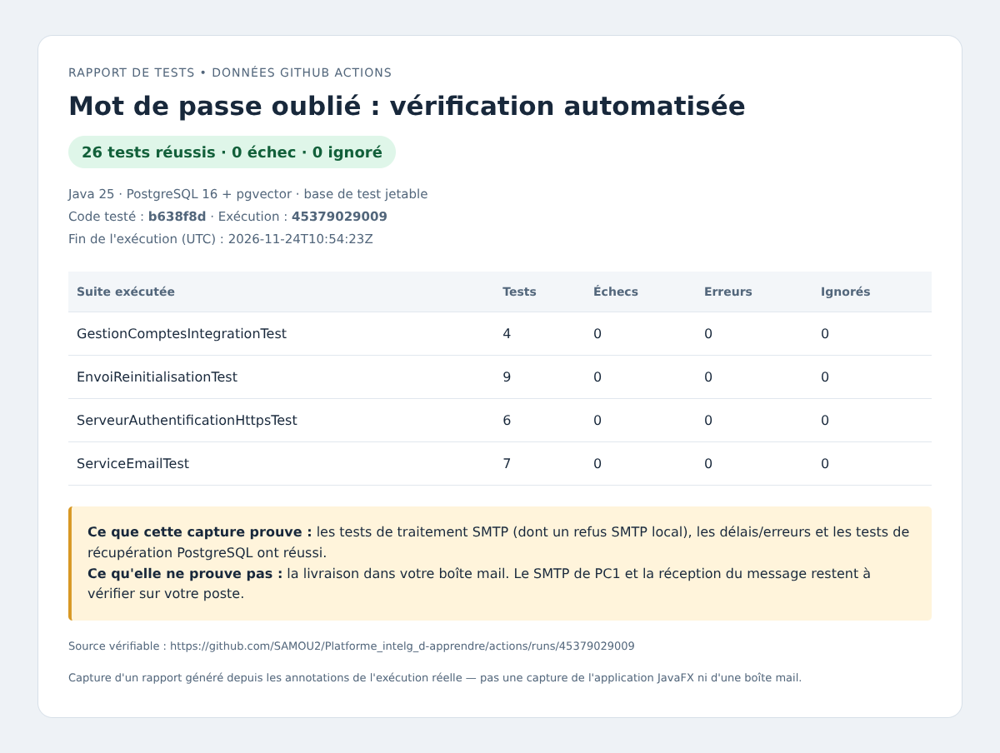

# Vérification de la récupération du mot de passe

Cette capture représente un **rapport généré depuis les annotations réelles de GitHub Actions**,
provenant de l'exécution [45379029009](https://github.com/SAMOU2/Platforme_intelg_d-apprendre/actions/runs/45379029009),
sur le code `b638f8d`. Ce n'est ni une capture de l'application JavaFX, ni une preuve de réception
dans une boîte mail réelle.

Résultat : **26 tests exécutés, aucun échec, aucune erreur, aucun test ignoré**.

| Suite | Tests |
| --- | ---: |
| EnvoiReinitialisationTest | 9 |
| ServiceEmailTest | 7 |
| ServeurAuthentificationHttpsTest | 6 |
| GestionComptesIntegrationTest | 4 |

La vérification utilise Java 25 et une base PostgreSQL 16 + pgvector jetable, avec les migrations
appliquées. Elle couvre notamment l'attente du résultat avant succès, un refus SMTP réel sur un
serveur local de test, la configuration manquante, les exceptions SQL, les délais dépassés,
l'interruption et la réinitialisation/révocation des sessions dans PostgreSQL.
Les rapports Surefire sont joints à cette exécution GitHub Actions (rétention : 14 jours).

## Vérification restant à effectuer sur PC1

1. Mettre à jour le code de la branche `arena/bdd4a78c-platforme-intelg-d-apprendre` sur les postes.
2. Redémarrer le service d'authentification PC1 et les clients avec le code recompilé.
3. Sur PC1, lancer `postes\tester-smtp.cmd votre-adresse@example.org` avec l'adresse de réception
   réelle. Ne jamais publier les secrets de `configuration-PC1.local.cmd`.
4. Vérifier la réception, les indésirables et la console PC1. Si l'interface signale une migration
   manquante, sauvegarder la base et appliquer la migration 15 selon [le guide](../recuperation-et-suppression-comptes.md).
5. Depuis un compte de test actif et accepté, demander un code, vérifier sa réception puis modifier
   le mot de passe. Ne pas partager le code ni le nouveau mot de passe dans une capture.

Le diagnostic SMTP de PC1 est indispensable pour identifier la cause concrète du problème de
livraison : ces tests n'utilisent ni les identifiants SMTP privés de PC1, ni la boîte mail de l'utilisateur.

## Recette réelle sur PC1 — 24 novembre 2026

La réinitialisation a été **exécutée avec succès sur la plateforme déployée** : code demandé depuis
l'écran de connexion, courriel reçu, code saisi, nouveau mot de passe accepté, puis connexion avec
le nouveau mot de passe.

Ce résultat valide la chaîne complète (interface → service HTTPS → SMTP réel → PostgreSQL →
révocation des sessions), ce que les 26 tests automatisés ci-dessus ne pouvaient pas couvrir : ils
n'utilisent ni les identifiants SMTP privés de PC1, ni une boîte mail réelle. Les étapes 1 à 5 de la
section précédente sont donc considérées comme vérifiées, à l'exception de la vérification des
courriers indésirables qui dépend du fournisseur.

Aucun code, mot de passe ni secret de configuration ne doit être joint à cette note.
