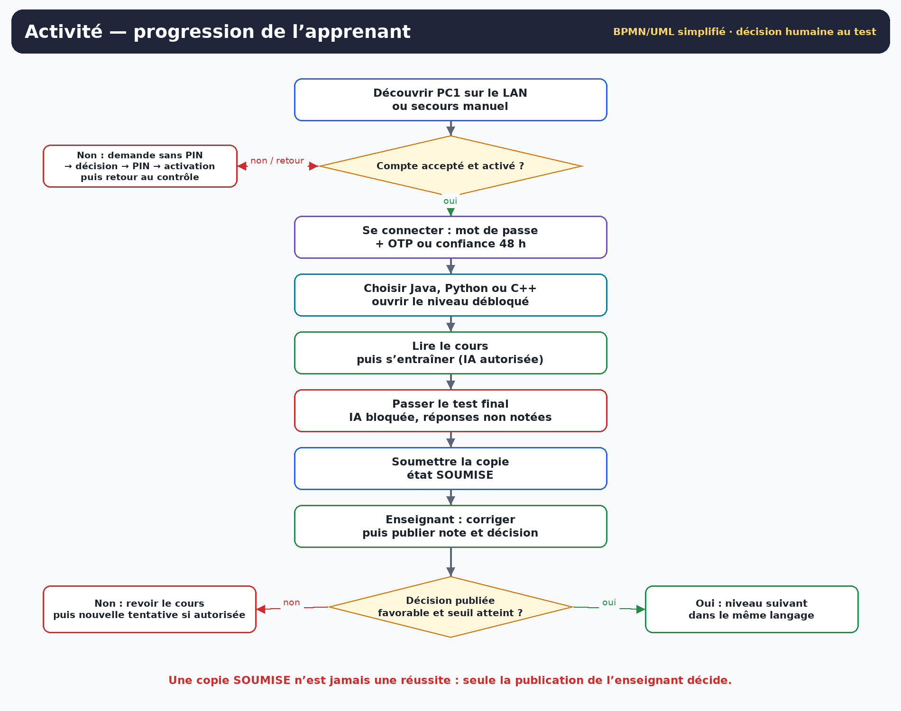
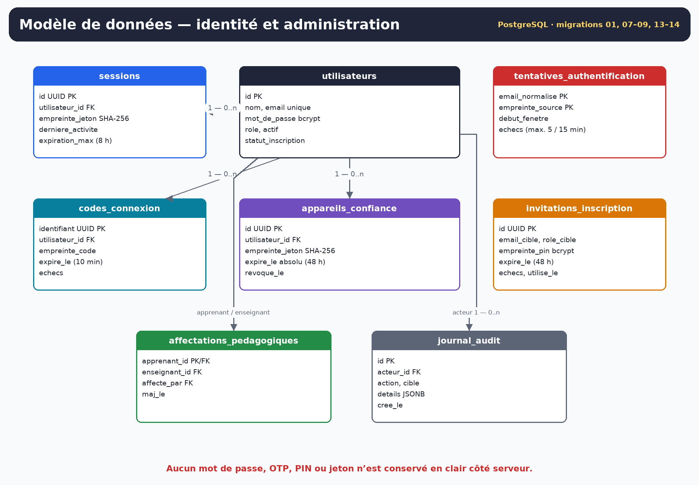
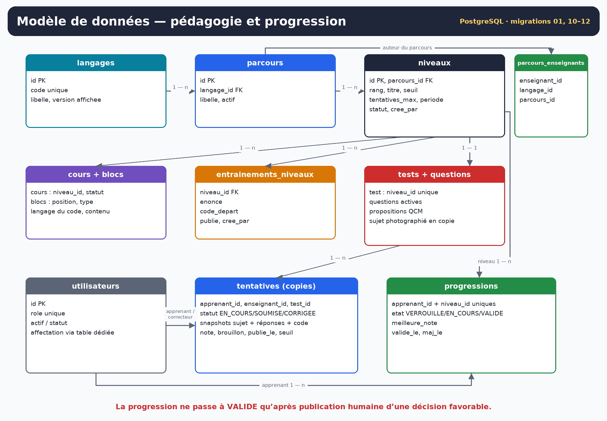

<!-- title: Analyse des besoins fonctionnels -->
<!-- subtitle: Plateforme d’apprentissage de la programmation par niveaux — Java, Python et C++ -->
<!-- short: Analyse des besoins fonctionnels -->
<!-- version: Version 2.0 -->
<!-- date: 3 novembre 2026 -->
<!-- baseline: Application 0.14.4 · branche main après PR #31 (2ae972b) -->
<!-- status: Mise à jour normative alignée sur la version livrée -->

# 0. Objet, méthode et règle de priorité

Cette version 2.0 remplace l’analyse v1.3 jointe au projet. Elle ne se contente pas d’ajouter un errata : les hypothèses devenues fausses sont remplacées par les décisions réellement implémentées dans le dépôt, notamment le serveur central PC1, l’authentification complète, la correction humaine des tests finaux, le bot de tri des inscriptions, NVIDIA Nemotron via PC1, l’accessibilité clavier/lecteur d’écran et les retours d’état UX.

Les sources utilisées sont, par ordre de priorité :

1. le code Java, les migrations SQL 01 à 14, les lanceurs `postes/` et le `pom.xml` ;
2. les contrats et guides du dépôt : authentification, appareil de confiance 48 h, scalabilité des inscriptions, parcours par niveau, correction enseignant, NVIDIA, découverte réseau, ports automatiques, accessibilité et UX ;
3. les documents v1 fournis : analyse des besoins, diagrammes et modèles de tâches ;
4. les décisions explicites du porteur du projet pendant les itérations : Docker uniquement sur PC1, adresse LAN réelle, PIN seulement après acceptation, code e-mail renouvelé après 48 h sur poste de confiance, enseignant seul correcteur des tests finaux, aucun modèle IA local.

En cas de contradiction, **la présente v2.0 et le cahier des charges v1.0 priment sur les formulations v1**. Les exigences sont marquées :

| Marque | Signification |
|---|---|
| **Livré** | Présent dans le code de la référence logicielle. |
| **Livré avec limites** | Présent, mais périmètre ou preuve incomplets. |
| **Recette Windows** | Implémentation présente ; validation réelle JavaFX, réseau, SMTP, NVIDIA ou NVDA encore à consigner. |
| **Extension** | Hors périmètre livré ; ne doit pas être présenté comme acquis. |
| **Remplacé** | Ancienne hypothèse v1 abandonnée ou corrigée. |

La v1.3 annonçait 74 besoins fonctionnels, 35 besoins non fonctionnels, 39 exigences IHM et 24 règles de gestion. La v2.0 consolide ce catalogue autour du comportement observable du produit livré : **57 besoins fonctionnels**, **18 besoins non fonctionnels**, **20 exigences IHM/UX/accessibilité**, **24 règles de gestion** et **14 cas d’utilisation**. La réduction du nombre ne signifie pas une réduction du produit : plusieurs besoins v1 redondants ou devenus faux ont été fusionnés, remplacés ou déplacés en extensions.

# 1. Contexte, problème et finalité

La plateforme aide un apprenant à progresser dans un langage de programmation par niveaux successifs. Le problème central n’est pas uniquement de diffuser des cours : il faut garantir qu’un niveau n’est validé que lorsque les prérequis sont réellement atteints, tout en gardant la décision pédagogique entre les mains de l’enseignant.

La solution livrée est une application JavaFX multi-postes. Un poste central **PC1** héberge PostgreSQL dans Docker, le service d’authentification et de pédagogie en HTTPS et le serveur de salle/découverte. Les postes administrateur, enseignant et apprenant exécutent le client JavaFX sans Docker ni accès direct à la base.

Chaque niveau suit la chaîne :

**Cours → Entraînement avec IA → Test final sans IA → Soumission → Correction par l’enseignant → Note et décision publiées → Niveau suivant si validé.**

Le système applique les contrôles d’accès, les états, les seuils photographiés et la progression. Il ne note pas le test final et ne décide pas à la place de l’enseignant.

## 1.1 Objectifs produits

| ID | Objectif | Indicateur observable |
|---|---|---|
| OBJ-01 | Rendre la progression par niveau visible et contrôlable | États verrouillé/en cours/validé, seuil, tentatives et décision publiés. |
| OBJ-02 | Séparer administration, pédagogie et apprentissage | Trois rôles serveur, postes dédiés, autorisations revérifiées par PC1. |
| OBJ-03 | Éviter le traitement manuel d’un très grand nombre d’inscriptions | Bot de règles pour apprenants éligibles, filtres SQL, pagination et décisions par lot. |
| OBJ-04 | Sécuriser l’identité sans rendre chaque ouverture pénible | PIN d’activation, OTP de connexion et poste de confiance limité à 48 h avec mot de passe toujours exigé. |
| OBJ-05 | Aider pendant l’entraînement sans tricher au test | IA conversationnelle en entraînement, bloquée pendant une tentative finale réelle. |
| OBJ-06 | Fonctionner dans une salle sans saisie d’IP par l’utilisateur | Découverte LAN, adresse réelle, port HTTPS dynamique et secours manuel. |
| OBJ-07 | Rendre l’IHM utilisable au clavier et plus lisible | Boutons réels, noms accessibles, F1/F6/F8, thèmes, bandeaux d’état et erreurs exactes. |

## 1.2 Pile technique constatée

| Couche | Choix livré | Conséquence |
|---|---|---|
| Runtime | Java 25 LTS, bytecode 25 | Les lanceurs doivent refuser ou signaler un JDK incompatible. |
| Interface | JavaFX 25.0.5, vues construites en Java, AtlantaFX 2.0.1 et CSS du projet | Pas de FXML dans les vues livrées ; thèmes clair, sombre et rétro. |
| Construction | Maven Wrapper, JUnit 5, Jackson, Angus Mail, pilote PostgreSQL | `mvnw.cmd` est la commande Windows de référence. |
| Serveur PC1 | Service Java HTTPS, serveur de salle/découverte, PostgreSQL via Docker Compose | Les clients ne portent ni Docker ni secrets serveur. |
| Données | PostgreSQL, migrations 01 à 14 | Les bases existantes doivent être sauvegardées puis migrées sans supprimer le volume. |
| IA | NVIDIA `nvidia/nemotron-3.5-bolt-e4b` appelé uniquement par PC1 | Aucun modèle local ni clé NVIDIA côté client. |
| E-mail | SMTP configuré uniquement sur PC1 | Décisions d’inscription, PIN d’activation et OTP de connexion. |

# 2. Acteurs, postes et droits

## 2.1 Acteurs humains

| Acteur | Poste de référence | Responsabilité | Ne doit pas faire |
|---|---|---|---|
| Administrateur | PC2 | Comptes, demandes, activation/désactivation, renvoi de PIN, affectation apprenant-enseignant, supervision | Devenir le passage obligé pour créer chaque contenu pédagogique ; voir les secrets en clair |
| Enseignant | PC3 | Créer ses niveaux, préparer cours/entraînement/test, publier, suivre ses apprenants, corriger et décider | Modifier les parcours d’un autre enseignant ou corriger une copie non affectée |
| Apprenant | PC4 | Demander un compte, activer, se connecter, étudier, s’entraîner, passer le test, lire la décision | Choisir son rôle, contourner un verrou, utiliser l’IA au test final |

Les quatre postes logiques — PC1 serveur et les trois rôles clients — peuvent être testés sur une même machine avec des lanceurs distincts, mais le déploiement de référence reste PC1 serveur et des postes clients par rôle.

## 2.2 Acteurs système et externes

| Acteur système | Rôle | Garde-fou |
|---|---|---|
| PC1 HTTPS | Authentification, autorisations, comptes, pédagogie, relais IA | Rôle lu depuis la session et PostgreSQL, jamais depuis le client |
| Serveur de salle | Présence et découverte du nom, de l’adresse et du port HTTPS | La découverte n’authentifie pas ; TLS reste obligatoire |
| PostgreSQL | Persistance des comptes, contenus, copies, progressions, sessions et audit | Accessible aux services PC1, pas directement aux clients |
| Bot de tri des inscriptions | Règles explicables sur rôle et domaine e-mail | Pré-accepte uniquement des apprenants éligibles ; jamais un enseignant |
| Assistant IA | Explications et exemples en entraînement | Ne note pas, ne valide pas, ne débloque pas et est bloqué au test final |
| SMTP | Envoi des décisions, PIN et OTP | Secrets uniquement sur PC1 ; un échec SMTP n’annule pas une décision enregistrée |
| NVIDIA | Fournisseur du modèle distant | Appel sortant depuis PC1 uniquement ; question et code d’entraînement transmis |
| Windows | Wi-Fi, profils utilisateur, pare-feu et magasin de confiance du JDK | La plateforme ne collecte pas les mots de passe Wi-Fi |

## 2.3 Matrice synthétique des droits

| Capacité | Apprenant | Enseignant | Administrateur | Système PC1 |
|---|---:|---:|---:|---:|
| Demander un compte | Oui | Oui | Non en inscription publique | Crée `EN_ATTENTE` inactif |
| Pré-accepter une demande | Non | Non | Oui | Bot : apprenant éligible uniquement |
| Activer avec PIN | Oui | Oui | Compte initial par amorçage | Vérifie PIN, rôle, expiration et essais |
| Créer un niveau | Non | Oui, le sien | Non dans le parcours enseignant | Vérifie l’auteur |
| Publier un niveau | Non | Oui, le sien et complet | Non à la place de l’auteur | Vérifie ordre et complétude |
| Passer le test | Oui, si éligible | Non | Non | Crée la tentative et bloque l’IA |
| Corriger | Non | Oui, copies affectées | Non dans le parcours normal | Brouillon privé puis publication |
| Valider/débloquer | Non | Décision publiée | Non | Applique seuil et progression |
| Affecter un apprenant | Non | Non | Oui | Une affectation active par apprenant |
| Utiliser l’IA | Oui, en entraînement | Non pour corriger ou valider | Non | Session, quotas et garde-fous |

# 3. Besoins fonctionnels

## 3.1 BF-U — Comptes, activation et connexion

| ID | Besoin | Priorité | État |
|---|---|---:|---|
| BF-U01 | Un poste apprenant ou enseignant permet de demander un compte avec nom, e-mail et mot de passe, sans PIN initial. Le rôle demandé est celui du poste ; l’inscription publique d’un administrateur est refusée. | P0 | Livré |
| BF-U02 | Toute demande crée un compte `EN_ATTENTE` et inactif, avec e-mail unique sans distinction de casse. | P0 | Livré |
| BF-U03 | Après acceptation, le demandeur reçoit un PIN d’activation à 8 chiffres, valable 48 h, à usage unique et limité à cinq essais. | P0 | Livré |
| BF-U04 | L’activation exige le même e-mail et le rôle du poste ; elle rend le compte actif sans ouvrir automatiquement une session. | P0 | Livré |
| BF-U05 | La connexion vérifie le mot de passe côté PC1 et retourne uniquement le rôle enregistré en base. | P0 | Livré |
| BF-U06 | Sans poste de confiance valide, un OTP à 6 chiffres est envoyé par e-mail, valable 10 minutes, à usage unique et limité à cinq échecs. | P0 | Livré |
| BF-U07 | Après OTP valide, l’utilisateur peut explicitement faire confiance au poste pendant 48 h absolues. Le mot de passe reste exigé à chaque ouverture. | P0 | Livré |
| BF-U08 | « Oublier ce poste de confiance » supprime le jeton local et demande sa révocation ; la désactivation du compte révoque toutes les confiances. | P0 | Livré |
| BF-U09 | La session expire après 30 minutes d’inactivité et au plus tard après 8 heures ; la déconnexion la révoque. | P0 | Livré |
| BF-U10 | Les refus d’identifiants sont génériques et la connexion est limitée à cinq échecs par compte/source sur 15 minutes. | P0 | Livré |

## 3.2 BF-A — Administration et scalabilité des inscriptions

| ID | Besoin | Priorité | État |
|---|---|---:|---|
| BF-A01 | Le bot PC1 peut rester manuel, pré-accepter des apprenants de domaines autorisés ou, en mode explicitement ouvert, des apprenants non bloqués. | P0 | Livré |
| BF-A02 | Le bot affiche un avis et un motif explicables dans la file administrateur ; il n’utilise ni NVIDIA ni le mot de passe. | P1 | Livré |
| BF-A03 | La liste des comptes est filtrée et paginée par PostgreSQL : texte, domaine, statut, rôle et état actif/inactif ; 50 lignes par page dans l’IHM. | P0 | Livré |
| BF-A04 | L’administrateur accepte ou refuse une demande unitaire ou une sélection de la page ; le client découpe l’envoi en requêtes d’au plus 20 décisions et le serveur applique la même borne. | P0 | Livré |
| BF-A05 | Une acceptation crée le PIN et journalise la décision ; le rapport distingue éléments traités, erreurs et e-mails non envoyés. | P0 | Livré |
| BF-A06 | L’administrateur peut renvoyer un PIN pour un compte accepté encore inactif ; l’ancien PIN est invalidé. | P1 | Livré |
| BF-A07 | L’administrateur peut créer un compte, activer ou désactiver un compte accepté et consulter les compteurs par statut. | P1 | Livré |
| BF-A08 | L’administrateur affecte un apprenant actif/accepté à un enseignant actif/accepté ; une réaffectation est bloquée si une copie reste ouverte. | P0 | Livré |
| BF-A09 | Le démarrage sans administrateur exige un amorçage explicite par variables d’environnement, puis ces variables doivent être retirées. | P0 | Livré |

## 3.3 BF-P — Parcours, niveaux et contenus

| ID | Besoin | Priorité | État |
|---|---|---:|---|
| BF-P01 | Trois parcours sont distingués par langage : Java, Python et C++ ; une validation dans un langage ne débloque rien dans un autre. | P0 | Livré |
| BF-P02 | L’enseignant crée ses niveaux en brouillon avec titre, seuil sur 20 et nombre maximal de tentatives ; le rang est attribué par le serveur. | P0 | Livré |
| BF-P03 | L’enseignant prépare le cours, l’entraînement et les questions du test final de ses niveaux, y compris avant publication. | P0 | Livré |
| BF-P04 | La publication d’un niveau exige cours, entraînement, questions actives et niveau précédent publié. | P0 | Livré |
| BF-P05 | Les brouillons et parcours privés d’un enseignant sont invisibles aux apprenants non affectés et aux autres enseignants. | P0 | Livré |
| BF-P06 | Chaque carte de niveau expose les étapes Cours, Entraînement avec IA et Test final sans IA, avec les indisponibilités explicites. | P0 | Livré |
| BF-P07 | Aucun cours, exercice ou sujet fictif n’est inventé pour masquer un contenu manquant. | P0 | Livré |
| BF-P08 | Les contenus publiés sont versionnés sans détruire les anciennes copies ni leurs sujets photographiés. | P1 | Livré avec limites |
| BF-P09 | Les vues apprenant connectées se rafraîchissent automatiquement par interrogation périodique de PC1, sans effacer un brouillon d’entraînement modifié. | P1 | Livré |
| BF-P10 | La première publication du parcours propre d’un enseignant bascule ses apprenants affectés dans ce langage ; les copies historiques restent consultables. | P1 | Livré |
| BF-P11 | Le changement de langage efface la sélection de niveau incompatible afin d’éviter d’ouvrir un contenu d’un autre parcours. | P1 | Livré |

## 3.4 BF-E — Test final, correction et progression

| ID | Besoin | Priorité | État |
|---|---|---:|---|
| BF-E01 | Le serveur contrôle publication, affectation, déblocage, période, contenus requis et tentatives restantes avant de créer une tentative. | P0 | Livré |
| BF-E02 | Une copie ouverte est `EN_COURS`, reprenable ; quitter l’écran ne la termine pas et l’abandon reste explicite (`ANNULEE`). | P0 | Livré |
| BF-E03 | Le sujet et le seuil sont photographiés à la création de la copie ; les réponses non soumises ne sont pas sauvegardées sur PC1. La soumission fige réponses et code puis passe à `SOUMISE`. | P0 | Livré |
| BF-E04 | Après soumission, l’apprenant ne voit ni note, ni corrigé, ni commentaire, ni décision avant publication. | P0 | Livré |
| BF-E05 | Seul l’enseignant affecté voit et corrige la copie ; son identité vient de la session. | P0 | Livré |
| BF-E06 | L’enseignant peut enregistrer un brouillon privé de note, commentaire et décision sans le rendre visible. | P1 | Livré |
| BF-E07 | La publication exige confirmation, une note de 0 à 20, un commentaire et une décision ; une validation exige la note au moins égale au seuil photographié. | P0 | Livré |
| BF-E08 | Une décision favorable publiée passe la progression à `VALIDE` et débloque le niveau suivant du même parcours. Un refus ne débloque rien. | P0 | Livré |
| BF-E09 | Une validation acquise n’est pas retirée par un changement ultérieur de seuil ou de contenu. | P0 | Livré |
| BF-E10 | Le test final ne produit aucune correction automatique et aucun score côté apprenant avant correction humaine. | P0 | Livré |
| BF-E11 | Les listes actuelles de copies sont bornées ; une pagination complète des copies reste une extension avant très grande échelle. | P2 | Extension |

## 3.5 BF-IA — Assistant pédagogique

| ID | Besoin | Priorité | État |
|---|---|---:|---|
| BF-IA01 | L’assistant est disponible dans le cours et l’entraînement après authentification, via `/api/ia/aide` sur PC1. | P1 | Livré |
| BF-IA02 | Le fournisseur est NVIDIA Nemotron 3.5 Bolt E4B ; aucun poids local et aucun appel direct depuis le client. | P1 | Livré |
| BF-IA03 | L’assistant reconnaît les salutations, garde au plus trois échanges récents du panneau et peut expliquer avec étapes et exemple distinct, jusqu’à 2400 caractères. | P2 | Livré |
| BF-IA04 | Les réponses doivent respecter un format structuré et citer uniquement des extraits fournis du corpus. | P1 | Livré avec limites |
| BF-IA05 | Les demandes de note, validation, déblocage ou solution complète sont refusées par garde-fous d’entrée et de sortie. | P0 | Livré |
| BF-IA06 | Toute tentative réelle `EN_COURS` bloque l’aide IA côté PC1, y compris depuis une autre fenêtre du même compte. | P0 | Livré |
| BF-IA07 | Les appels sont bornés par quotas, taille, délai et une requête à la fois ; absence de clé ou erreur fournisseur donne une indisponibilité sans secret. | P1 | Livré |
| BF-IA08 | Le cours rédigé par l’enseignant dans PostgreSQL n’est pas encore indexé comme corpus de l’assistant ; le corpus embarqué reste la source citable. | P2 | Limite connue |

## 3.6 BF-R — Réseau, découverte et exploitation

| ID | Besoin | Priorité | État |
|---|---|---:|---|
| BF-R01 | Le client découvre automatiquement la plateforme sur le LAN ; une seule plateforme est sélectionnée, plusieurs exigent un choix explicite. | P0 | Livré |
| BF-R02 | Windows gère le Wi-Fi et ses secrets ; l’application propose Réessayer et l’ouverture des paramètres Windows, sans scanner les SSID. | P1 | Livré |
| BF-R03 | L’adresse utilisée est une adresse LAN réelle ; le secours manuel permet adresse et port HTTPS, sans imposer 127.0.0.1 à l’utilisateur. | P0 | Livré |
| BF-R04 | Le port HTTPS peut être attribué dynamiquement par le système et annoncé par la découverte v3 ; une seule instance HTTPS par dossier projet est autorisée. | P1 | Livré |
| BF-R05 | Un mode TLS explicite peut renouveler le certificat serveur pour les IPv4 actives avec une CA privée créée et approuvée manuellement. | P1 | Livré, recette Windows |
| BF-R06 | Le lanceur PC1 démarre ou attend Docker/PostgreSQL avant HTTPS et annonce les diagnostics sans afficher les secrets. | P1 | Livré |
| BF-R07 | Les postes sont lancés par des scripts de rôle Windows/Linux qui vérifient le JDK et propagent les échecs. | P1 | Livré |
| BF-R08 | Si PC1 ou le réseau est inaccessible, l’utilisateur reçoit la cause exacte disponible et une action de reprise ; les anciennes données affichées sont signalées comme telles. | P1 | Livré |

# 4. Règles de gestion

| ID | Règle normative |
|---|---|
| RG-01 | Un compte possède exactement un rôle serveur : administrateur, enseignant ou apprenant. |
| RG-02 | Le rôle du lanceur décrit le poste attendu, mais l’autorisation vient du rôle du compte et de la session PC1. |
| RG-03 | Une demande publique démarre `EN_ATTENTE` et inactive ; aucun PIN n’est demandé à ce stade. |
| RG-04 | Le PIN d’activation est distinct de l’OTP de connexion : 8 chiffres/48 h contre 6 chiffres/10 min. |
| RG-05 | Le bot ne pré-accepte jamais un enseignant et ne contourne ni le PIN ni le mot de passe ni l’OTP initial. |
| RG-06 | Le mot de passe contient au moins 12 caractères et au plus 72 octets UTF-8 ; il est haché avec bcrypt côté serveur. |
| RG-07 | La confiance 48 h est opt-in, absolue, créée après OTP et ne supprime jamais la vérification du mot de passe. |
| RG-08 | Fermer ou se déconnecter révoque la session, pas automatiquement la confiance ; seul l’oubli explicite ou la désactivation la révoque avant échéance. |
| RG-09 | Un parcours est propre à un langage ; pour les nouveaux parcours, il est aussi propre à l’enseignant auteur. |
| RG-10 | Un niveau brouillon est invisible aux apprenants ; un niveau publié suit l’ordre des rangs. |
| RG-11 | Un niveau n’est testable que si cours, entraînement et questions sont disponibles et si le niveau est débloqué. |
| RG-12 | L’enseignant est l’auteur pédagogique normal ; l’administrateur ne doit pas être un passage obligé de création de contenu. |
| RG-13 | Une seule copie ouverte par apprenant et test dans le parcours réel. |
| RG-14 | Quitter l’écran ne soumet ni n’abandonne une copie ; ces transitions sont explicites. |
| RG-15 | Le sujet, les réponses, le code et le seuil d’une copie soumise sont photographiés et ne changent pas lors d’une republication. |
| RG-16 | Le brouillon de correction est privé ; seule la publication rend note, commentaire et décision opposables à l’apprenant. |
| RG-17 | Une validation publiée exige une note supérieure ou égale au seuil photographié. |
| RG-18 | Une progression `VALIDE` est acquise et ne peut pas être retirée par un changement ultérieur. |
| RG-19 | L’IA ne note pas, ne corrige pas le test final, ne valide pas et ne débloque pas. |
| RG-20 | Pendant une tentative finale `EN_COURS`, l’IA est bloquée côté PC1 même si le client est modifié. |
| RG-21 | Le code saisi dans le parcours connecté n’est pas exécuté par la version livrée ; aucun résultat d’exécution fictif ne doit être présenté comme réel. |
| RG-22 | Les secrets DB, TLS, SMTP et NVIDIA restent sur PC1 ; les erreurs et journaux ne doivent pas les révéler. |
| RG-23 | La découverte réseau ne remplace ni TLS ni l’authentification du compte. |
| RG-24 | Une ancienne liste conservée après échec doit être présentée comme périmée, jamais comme résultat du nouveau filtre. |

# 5. Besoins non fonctionnels

| ID | Domaine | Exigence |
|---|---|---|
| BNF-01 | Sécurité transport | HTTPS strict pour credentials, PIN, OTP, sessions, pédagogie et IA ; aucun repli HTTP silencieux. |
| BNF-02 | Secrets | Mots de passe et PIN en bcrypt ; sessions et confiances en empreintes SHA-256 ; aucun secret en clair dans Git, les journaux ou les réponses. |
| BNF-03 | Autorisation | Contrôle de session et de rôle sur chaque route protégée, indépendamment de l’IHM. |
| BNF-04 | Anti-abus | Cinq échecs de connexion par compte/source en 15 minutes ; OTP et PIN bornés ; quotas IA et corps de requête limités. |
| BNF-05 | Confidentialité IA | NVIDIA reçoit question, code d’entraînement et extraits, sans nom, e-mail, jeton ni mot de passe ajoutés par l’application ; l’utilisateur est averti de ne pas saisir de données privées. |
| BNF-06 | Audit | Décisions de comptes et opérations sensibles journalisées sans secret ; l’origine bot/admin est distinguée. |
| BNF-07 | Scalabilité comptes | Requêtes SQL paramétrées, index de file/filtres, pagination et lots bornés ; aucune preuve de charge à 100 000 comptes n’est encore revendiquée. |
| BNF-08 | Performance d’usage | Les appels réseau sont hors du fil JavaFX ; les listes paginées et l’actualisation évitent de reconstruire inutilement l’écran. Les seuils chiffrés restent à mesurer sur le LAN cible. |
| BNF-09 | Disponibilité | PC1 doit être allumé et joignable pendant l’usage ; aucun mode hors ligne connecté n’est promis. |
| BNF-10 | Intégrité | Contraintes SQL, snapshots de copies, transitions transactionnelles de progression et protection d’une validation acquise. |
| BNF-11 | Portabilité | Java 25 et Maven Wrapper ; Windows est la cible principale, des lanceurs Linux existent ; aucun installateur autonome n’est livré à ce stade. |
| BNF-12 | Maintenabilité | Séparation UI, noyau, réseau, API, services et persistance ; migrations numérotées et non destructives. |
| BNF-13 | Exploitabilité | Diagnostics de démarrage sans valeurs secrètes, messages de port réel, état Docker/PostgreSQL et codes d’indisponibilité IA. |
| BNF-14 | Sauvegarde | Toute migration sur base existante exige une sauvegarde préalable ; aucun `down -v`, prune de volume ou effacement de configuration privée. |
| BNF-15 | Accessibilité technique | Contrôles JavaFX réels, noms accessibles, focus visible et raccourcis ; aucune certification WCAG/RGAA n’est revendiquée sans recette NVDA. |
| BNF-16 | Robustesse réseau | Découverte bornée, secours manuel, port dynamique et messages de reprise ; les Wi-Fi isolant les clients ne sont pas contournés. |
| BNF-17 | Testabilité | Tests JUnit, intégration PostgreSQL conditionnelle, contrôles Python structurels et recettes Windows par rôle. |
| BNF-18 | Traçabilité documentaire | Chaque décision structurante renvoie au code, à une migration ou à un guide de recette du dépôt. |

# 6. Besoins IHM, UX et accessibilité

| ID | Exigence |
|---|---|
| IHM-01 | Chaque poste affiche son rôle fixé et n’ouvre les écrans métier qu’après session valide du même rôle serveur. |
| IHM-02 | L’état de découverte indique recherche, plateforme prête, choix multiple ou plateforme introuvable, avec Réessayer. |
| IHM-03 | L’état principal de connexion est un bandeau sous le bouton d’action, avec symbole, texte complet, couleur et indicateur de chargement. |
| IHM-04 | Sur petit écran, les formulaires défilent et les messages importants deviennent visibles sans voler le focus. |
| IHM-05 | Les notifications asynchrones donnent la cause exacte ; la même erreur déjà visible n’est pas recréée en boucle. |
| IHM-06 | La barre latérale se réduit de 244 px à un rail d’icônes de 76 px depuis le bouton hamburger en haut à gauche ; les noms complets et infobulles subsistent. |
| IHM-07 | Chaque destination possède icône, libellé et couleur sémantique ; la couleur n’est jamais le seul repère et l’écran courant reste identifiable. |
| IHM-08 | Les thèmes clair, sombre et rétro partagent les mêmes états et contrastes fonctionnels. |
| IHM-09 | Les champs de mot de passe restent masqués par défaut et disposent d’un bouton Afficher/Masquer nommé par champ. |
| IHM-10 | Les cartes de niveau annoncent rang, titre, état, seuil, tentatives et raison d’indisponibilité ; le verrouillage est expliqué. |
| IHM-11 | Les boutons désactivés pour contenu « en préparation » ne doivent pas conduire à un écran vide ou à une erreur générique. |
| IHM-12 | Dans Comptes et rôles, les filtres déroulants s’appliquent immédiatement ; la saisie texte attend 400 ms ; Entrée et Filtrer forcent l’application. |
| IHM-13 | La liste administrateur distingue chargement, liste à jour, aucun résultat filtré, aucun compte et anciennes lignes après erreur, avec Réessayer. |
| IHM-14 | Les décisions destructives ou définitives demandent confirmation ; une publication de correction est explicite. |
| IHM-15 | La navigation et les actions principales sont de vrais boutons activables au clavier et par technologie d’assistance. |
| IHM-16 | F1 ouvre l’aide, F6/Maj+F6 change de région et F8 relit la dernière notification sans déclencher d’action métier. |
| IHM-17 | Les champs de test associent l’énoncé au contrôle ; les secrets masqués ne sont jamais inclus dans un nom accessible. |
| IHM-18 | Les animations expliquent un changement d’état et peuvent être désactivées par `-Dihm.animations=off` ; aucun rafraîchissement ne vole le focus. |
| IHM-19 | Les fenêtres et dialogues doivent rester lisibles en 1280×720 et sur portable plus petit, avec défilement plutôt que débordement inaccessible. |
| IHM-20 | Les erreurs sont formulées près de l’action, en français clair, avec l’étape de reprise lorsqu’elle existe. |

# 7. Cas d’utilisation

| ID | Cas | Acteur principal | Résultat observable |
|---|---|---|---|
| UC-01 | Découvrir et choisir la plateforme | Tous | PC1 sélectionné automatiquement ou choix explicite ; secours manuel possible |
| UC-02 | Demander un compte | Apprenant/enseignant | Demande `EN_ATTENTE` inactive, sans PIN |
| UC-03 | Pré-accepter ou décider une demande | Bot/admin | PIN créé si acceptée, refus journalisé sinon |
| UC-04 | Activer un compte | Demandeur accepté | Compte actif après PIN valide |
| UC-05 | Se connecter avec OTP | Tous | Session du rôle serveur ouverte |
| UC-06 | Rouvrir avec poste de confiance | Tous | Mot de passe seul pendant 48 h après OTP initial |
| UC-07 | Oublier un poste de confiance | Tous | Jeton local supprimé, révocation demandée, OTP au prochain accès |
| UC-08 | Administrer comptes et affectations | Admin | Filtres, lots, PIN, activation et affectation à jour |
| UC-09 | Créer et publier un niveau | Enseignant | Brouillon complété puis niveau visible aux apprenants affectés |
| UC-10 | Étudier et s’entraîner | Apprenant | Cours lu, exercice et aide IA en entraînement |
| UC-11 | Passer et soumettre le test final | Apprenant | Copie `SOUMISE`, sans note automatique |
| UC-12 | Corriger et publier | Enseignant affecté | Note, commentaire et décision visibles après publication |
| UC-13 | Consulter sa progression | Apprenant | Niveau suivant débloqué seulement si décision favorable |
| UC-14 | Exploiter et diagnostiquer PC1 | Admin/exploitant | Docker, HTTPS, salle et port réel vérifiés sans exposer de secret |

## 7.1 Flux critique — de la demande à la première connexion

1. Le demandeur ouvre le poste correspondant à son rôle et envoie sa demande sans PIN.
2. PC1 crée le compte en attente et inactif.
3. Le bot pré-accepte uniquement un apprenant éligible ; sinon l’administrateur décide dans la file filtrée.
4. En cas d’acceptation, PC1 envoie le PIN à l’adresse du compte.
5. Le demandeur active le compte avec ce PIN.
6. Il se connecte avec mot de passe et OTP ; il peut alors choisir la confiance 48 h sur un poste personnel.

## 7.2 Flux critique — du niveau à la progression

1. L’enseignant crée le niveau, prépare les trois étapes et publie.
2. L’apprenant affecté lit le cours et s’entraîne ; l’IA peut expliquer sans exécuter le code.
3. Au test final, l’IA est bloquée et aucune note n’est calculée.
4. L’apprenant soumet ; l’enseignant affecté corrige en brouillon puis publie.
5. Le serveur met à jour la progression seulement après publication favorable et seuil atteint.

# 8. Modèle de données de référence

Le modèle logique livré est décrit par les migrations SQL. Les diagrammes détaillés figurent dans le dossier des diagrammes v2.0.

Points structurants :

- `utilisateurs.role` porte l’unique rôle du compte ; `actif` et `statut_inscription` sont deux dimensions distinctes.
- `sessions`, `codes_connexion` et `appareils_confiance` ne conservent que des empreintes.
- `invitations_inscription` conserve l’empreinte bcrypt du PIN, son expiration et ses échecs.
- `parcours_enseignants` relie un enseignant et un langage à son parcours propre.
- `tentatives` est la copie : snapshots JSON, code, seuil, brouillon privé et date de publication.
- `progressions` est protégée contre le retrait d’une validation acquise.
- `journal_audit` trace les actions sensibles sans secret.
- Le client conserve localement uniquement le jeton opaque de confiance par compte/rôle ; ni mot de passe, ni PIN, ni OTP.

# 9. Traçabilité objectifs → exigences → preuves

| Objectif | Exigences principales | Mise en œuvre / preuve dans le dépôt |
|---|---|---|
| OBJ-01 | BF-P06, BF-E01→E10, RG-17→18 | `PostgresPedagogieRepository`, migrations 10–12, vues Parcours/Test/Résultats |
| OBJ-02 | BF-U05, BF-A08, BF-P05, BNF-03 | `AuthentificationApiHttps`, sessions, lanceurs par rôle |
| OBJ-03 | BF-A01→A06, BNF-07 | `BotInscription`, `PostgresCompteRepository`, migration 13, `ComptesView` |
| OBJ-04 | BF-U01→U10, RG-03→08 | migrations 07–09 et 14, `PostgresAuthentificationService`, `MemoireAppareilConfiance` |
| OBJ-05 | BF-IA01→IA08, RG-19→21 | `/api/ia/aide`, garde-fous, verrou de tentative, guides NVIDIA/assistant |
| OBJ-06 | BF-R01→R06, BNF-16 | `DecouverteServeurs`, annonce v3, port dynamique, identité TLS optionnelle |
| OBJ-07 | IHM-01→20, BNF-15 | `Accessibilite`, `BarreLaterale`, `Notifications`, bandeaux d’état, CSS des trois thèmes |

Les contrôles Python structurels et les analyses syntaxiques ne remplacent pas la compilation Maven, les tests d’intégration PostgreSQL, les essais multi-postes, SMTP/NVIDIA réels ni la recette NVDA.

# 10. Décisions qui ferment les anciennes questions

| Question v1 | Décision v2.0 |
|---|---|
| Quels langages ? | Java, Python et C++ comme parcours distincts. |
| Quel runtime ? | Java 25 LTS et JavaFX 25.0.5 pour l’application ; les versions affichées des langages enseignés ne sont pas une promesse d’exécution. |
| FXML ou vues Java ? | Vues JavaFX construites en Java, AtlantaFX et CSS ; aucun FXML livré. |
| Correction automatique ? | Remplacée au test final par correction humaine obligatoire. Aucun score automatique n’est envoyé à l’apprenant. |
| Exécution du code ? | Hors périmètre du parcours connecté livré. Le code est transmis comme texte à l’enseignant et, en entraînement, éventuellement à l’IA ; un bac à sable reste une extension. |
| IA locale ou distante ? | Distante : NVIDIA Nemotron via PC1. Les modèles locaux ont été retirés. |
| Positionnements IA A/B ? | L’assistant agit dans la session authentifiée de l’utilisateur, sans compte propre. Le bot d’inscription est un moteur de règles séparé, pas un modèle de langage. |
| Validation d’e-mail par lien ? | Remplacée par PIN d’activation après acceptation, puis OTP de connexion distinct. |
| Adresse du serveur ? | Découverte automatique sur le LAN avec adresse réelle ; secours manuel adresse + port. |
| Administrateur pour 100 000 demandes ? | Bot d’apprenant explicable, file SQL filtrée/paginée et décisions par lot ; preuve de charge encore à mesurer. |
| Code e-mail à chaque ouverture ? | Poste de confiance explicite de 48 h, mot de passe toujours requis. |

# 11. Périmètre livré, limites et extensions

## 11.1 Périmètre de référence

- Application desktop JavaFX et services PC1 pour une salle ou un réseau local.
- Quatre postes logiques : PC1 serveur, PC2 administrateur, PC3 enseignant, PC4 apprenant.
- Parcours connecté réel pour comptes, contenus publiés par l’enseignant, copies, corrections et progressions.
- Administration scalable des demandes dans les limites documentées.
- Assistant IA en entraînement, sous réserve d’une clé NVIDIA et d’un accès sortant depuis PC1.

## 11.2 Limites à ne pas masquer

- Certains écrans historiques ou de démonstration subsistent en dehors du parcours connecté ; ils ne doivent pas être présentés comme des données réelles PC1.
- Pas d’exécution de code apprenant, pas de correction automatique du test, pas de chronomètre/expiration automatique de copie dans le parcours livré.
- L’éditeur pédagogique reste simple : pas d’éditeur riche multi-blocs complet, de barème détaillé par question, de transfert d’auteur ou de calendrier avancé.
- Les copies ne sont pas encore paginées comme les comptes ; SMTP est synchrone ; aucune charge de 100 000 comptes n’a été mesurée.
- Le corpus IA ne comprend pas encore les cours enseignants stockés en base.
- L’accessibilité est une première base ; NVDA et les captures JavaFX réelles restent à valider sous Windows.
- Aucun installateur autonome, service Windows, haute disponibilité ou mode hors ligne n’est livré.

## 11.3 Extensions possibles

1. Bac à sable d’exécution isolé avec quotas, journaux et tests de sécurité dédiés.
2. File transactionnelle d’e-mails, supervision et mesures de charge.
3. Pagination et recherche avancées des copies, groupes/classes et délégations administratives.
4. Indexation contrôlée des cours enseignants pour l’IA, avec droits et citations vérifiables.
5. Éditeur riche, banque de questions, barèmes par question et chronométrage serveur.
6. Installateur signé, service PC1 supervisé, sauvegarde/restauration guidée et métriques.
7. Recette d’accessibilité complète avec utilisateurs aveugles et correction des écarts NVDA.

# 12. Risques principaux

| Risque | Impact | Réponse retenue | Reste à prouver |
|---|---|---|---|
| PC1 éteint ou Docker en panne | Connexion et données indisponibles | Lanceur Docker, diagnostics, messages exacts | Recette de reprise Windows |
| Wi-Fi isolant ou IP changeante | Découverte ou TLS en échec | Adresse réelle, annonce du port, CA explicite optionnelle, secours manuel | Essais sur plusieurs réseaux |
| Fuite de configuration PC1 | Compromission DB/TLS/SMTP/NVIDIA | Fichier local ignoré par Git, secrets jamais affichés | Rotation des secrets déjà exposés à confirmer par l’exploitant |
| Poste de confiance sur machine partagée | Contournement de l’OTP pendant 48 h si mot de passe aussi connu | Opt-in, avertissement, oubli et révocation | Sensibilisation des utilisateurs |
| IA incorrecte ou trop aidante | Mauvais apprentissage ou triche | Corpus cité, format borné, refus, blocage test | Évaluation pédagogique réelle |
| Volume d’inscriptions | File humaine et SMTP saturés | Bot apprenant, index, pagination, lots | Test de charge et file e-mail |
| Accessibilité incomplète | Exclusion d’utilisateurs aveugles | Vrais boutons, noms, F6/F8, focus | Recette NVDA avec utilisateurs concernés |
| Contenus absents | Niveaux visibles mais non testables | États « en préparation », aucun contenu fictif | Production pédagogique par enseignant |

# 13. Glossaire et synthèse

| Terme | Définition v2.0 |
|---|---|
| PC1 | Poste central qui exécute Docker/PostgreSQL, le service HTTPS et le serveur de salle. |
| PIN d’activation | Code à 8 chiffres envoyé après acceptation ; il active le compte, valable 48 h. |
| OTP de connexion | Code à 6 chiffres envoyé à la connexion ; valable 10 minutes, distinct du PIN. |
| Poste de confiance | Jeton local opt-in permettant d’éviter un nouvel OTP pendant 48 h, sans supprimer le mot de passe. |
| Bot de tri | Moteur de règles serveur qui conseille ou pré-accepte uniquement certains apprenants ; ce n’est pas NVIDIA. |
| Copie | Tentative de test avec sujet, réponses, code et seuil photographiés. |
| Publication | Acte explicite de l’enseignant qui rend note, commentaire et décision visibles. |
| Parcours enseignant | Suite de niveaux propre à un enseignant dans un langage, visible à ses apprenants affectés après publication. |

**Synthèse.** La plateforme v2.0 est centrée sur une progression prouvable : PC1 protège les identités et les règles, l’enseignant crée et juge, l’apprenant avance niveau par niveau, et l’IA reste une aide d’entraînement bornée. Les gains UX et de scalabilité ne doivent jamais être présentés comme une validation pédagogique automatique.
