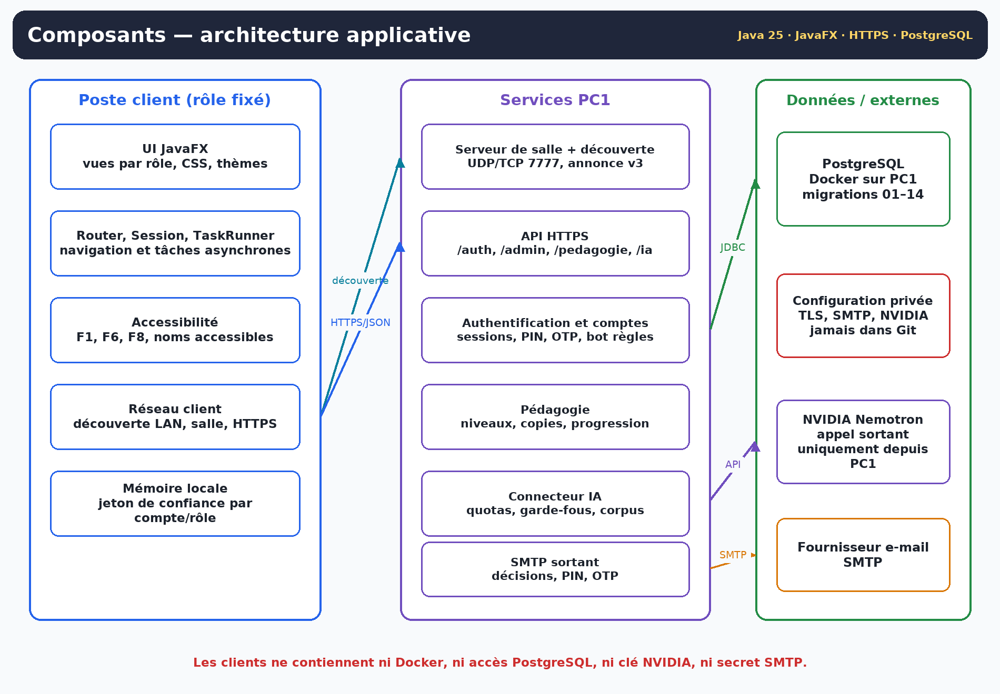
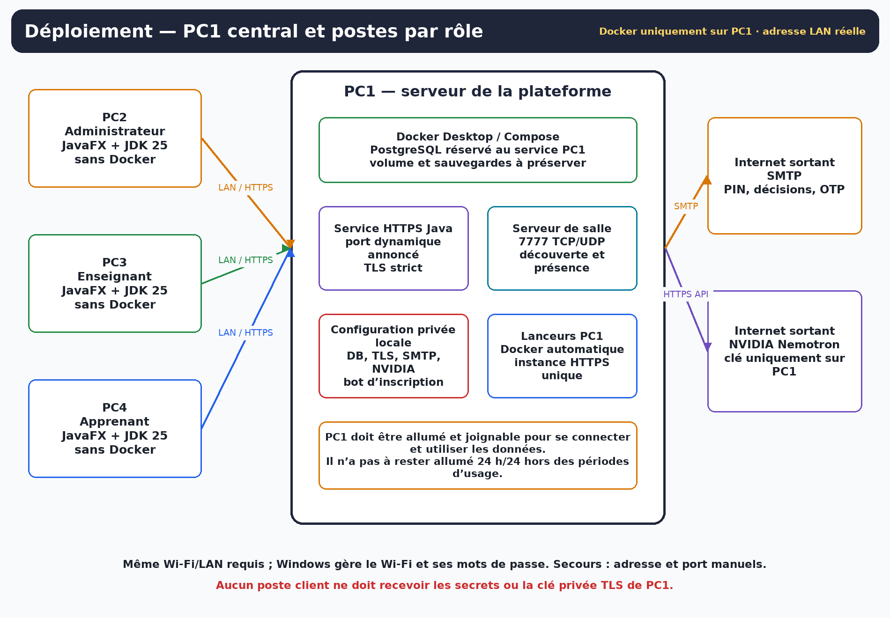

<!-- title: Cahier des charges -->
<!-- subtitle: Plateforme intelligente d’apprentissage de la programmation — exigences fonctionnelles, techniques, pédagogiques et de recette -->
<!-- short: Cahier des charges -->
<!-- version: Version 1.0 -->
<!-- date: 3 novembre 2026 -->
<!-- baseline: Application 0.14.4 · branche main après PR #31 (2ae972b) -->
<!-- status: Référence de périmètre alignée sur Analyse des besoins v2.0, Diagrammes v2.0 et Modèles de tâches v2.0 -->

# 1. Objet du document

Ce cahier des charges définit le périmètre, les exigences, les contraintes et les critères de recette de la **Plateforme intelligente d’apprentissage de la programmation**. Il constitue le document de référence pour vérifier que la version livrée répond au besoin académique et pédagogique sans mélanger les fonctions réellement disponibles, les limites connues et les évolutions futures.

La plateforme permet, dans une salle ou sur un réseau local :

- à un apprenant de suivre des niveaux Java, Python ou C++ préparés par son enseignant ;
- à un enseignant de créer et publier ses propres cours, entraînements et tests, puis de corriger humainement les copies ;
- à un administrateur de traiter les demandes de compte à grande échelle et d’affecter chaque apprenant à un enseignant ;
- à un assistant IA d’aider uniquement pendant l’entraînement, sans jamais corriger, noter ou valider ;
- à un poste central PC1 de faire autorité sur les identités, les contenus publiés, les copies et la progression.

La version de référence est **0.14.4**, sur la branche `main` après la PR #31 (`2ae972b`), avec les migrations PostgreSQL 01 à 14.

# 2. Documents applicables

| Document | Version | Rôle dans le référentiel |
|---|---|---|
| Analyse des besoins fonctionnels | v2.0, 3 novembre 2026 | Besoins BF, règles RG et exigences IHM détaillées |
| Diagrammes du projet | v2.0, 3 novembre 2026 | Cas d’utilisation, données, états, séquences, composants et déploiement |
| Modèles de tâches de la plateforme | v2.0, 3 novembre 2026 | Tâches HTA A0→UX1 et boucles d’erreur |
| README du dépôt | Version courante | Installation, lancement et commandes Windows |
| Documentation d’exploitation PC1 | Version courante | TLS, ports dynamiques, découverte, NVIDIA, accessibilité et preuves |
| Migrations PostgreSQL 01 à 14 | Version courante | Schéma et contraintes de données |

En cas de contradiction, l’ordre de priorité est : sécurité et règles serveur du code livré, ce cahier des charges, analyse des besoins, diagrammes, modèle de tâches, puis documents historiques. Les anciennes versions qui décrivent FXML/Scene Builder, JDK 21, une correction automatique ou un conteneur d’exécution du code sont remplacées.

# 3. Contexte et problèmes à résoudre

## 3.1 Contexte

Le projet s’inscrit dans un module d’interaction humain-machine. L’objectif n’est pas seulement d’afficher des cours : la plateforme doit démontrer une chaîne complète et cohérente entre identité, administration, pédagogie, assistance IA, accessibilité et retour d’information.

## 3.2 Problèmes traités

| Problème | Réponse exigée |
|---|---|
| Des postes indépendants produiraient des rôles et progressions incohérents | Un PC1 central décide en HTTPS à partir de PostgreSQL |
| Demander un PIN avant l’acceptation rend l’inscription impossible à expliquer | Demande sans PIN ; PIN envoyé uniquement après acceptation |
| Un code e-mail à chaque ouverture fatigue les utilisateurs légitimes | Poste de confiance explicite 48 h, mot de passe toujours requis |
| Un administrateur ne peut pas examiner 100 000 demandes une par une | Bot de règles apprenant, filtres SQL, pagination et lots bornés |
| Une IA ne doit pas tricher ni évaluer à la place de l’enseignant | IA uniquement en entraînement, bloquée au test, correction humaine |
| L’apprenant ne doit pas deviner si son test est corrigé | États `EN_COURS`, `SOUMISE`, brouillon privé, publication explicite |
| Les utilisateurs ne doivent pas manipuler d’adresses IP | Découverte automatique de PC1 et du port HTTPS réel |
| Les messages invisibles ou génériques empêchent le diagnostic | Bandeaux près de l’action et erreurs exactes, sans secret |
| L’accessibilité ne peut pas être une déduction visuelle | Noms accessibles, clavier, F1/F6/F8 et recette NVDA distincte |

# 4. Objectifs et indicateurs

| ID | Objectif | Indicateur de recette |
|---|---|---|
| OBJ-01 | Exploiter la plateforme sur un seul PC1 serveur et des postes clients légers | PC2/PC3/PC4 fonctionnent sans Docker ni accès JDBC direct |
| OBJ-02 | Garantir le rôle réel de chaque session | Un compte enseignant est rejeté sur un poste apprenant et inversement |
| OBJ-03 | Réduire l’OTP sans supprimer le mot de passe | Après OTP et opt-in, réouverture < 48 h sans code ; à 48 h, OTP à nouveau |
| OBJ-04 | Traiter une file de demandes volumineuse sans charger toute la base dans l’écran | Filtres SQL, page de 50, compteurs et lots bornés vérifiés |
| OBJ-05 | Rendre l’enseignant auteur et correcteur de ses niveaux | Niveau complet publié par E1, visible par ses apprenants, correction publiée par E2 |
| OBJ-06 | Empêcher toute validation automatique par IA ou interface | Aucun écran ni appel IA ne peut publier note/décision ni progression |
| OBJ-07 | Rejoindre PC1 sans saisir d’IP dans le cas nominal | Découverte d’une plateforme unique et connexion HTTPS au port annoncé |
| OBJ-08 | Donner un retour immédiat et localisé | État login/réseau et erreurs administrateur visibles près de l’action |
| OBJ-09 | Poser les fondations clavier/lecteur d’écran | Chemin nominal sans souris et noms accessibles ; recette NVDA consignée séparément |

# 5. Parties prenantes et acteurs

| Acteur | Responsabilité | Interdictions |
|---|---|---|
| Apprenant | Lire, s’entraîner, passer ses tests, lire ses décisions | Voir les copies d’autrui, utiliser l’IA au test, modifier sa progression |
| Enseignant | Créer ses niveaux et corriger ses apprenants affectés | Modifier un niveau ou une copie sans en être auteur/correcteur |
| Administrateur | Comptes, affectations, activation/désactivation, supervision | Créer les contenus pédagogiques à la place de l’enseignant |
| Exploitant PC1 | Démarrer Docker/HTTPS/salle, sauvegarder et diagnostiquer | Diffuser les secrets ou appliquer une réinitialisation destructive sans sauvegarde |
| Bot d’inscription | Pré-accepter certaines demandes apprenant selon le mode configuré | Pré-accepter un enseignant ou appliquer une règle opaque |
| Service SMTP | Envoyer décision, PIN et OTP | Recevoir le mot de passe du compte plateforme |
| NVIDIA Nemotron | Générer une aide d’entraînement à partir des données transmises par PC1 | Recevoir la clé par le client, noter ou valider |
| PostgreSQL | Persister comptes, contenus, copies, progression et journaux | Être joignable directement par un poste client |

Le rôle est stocké sur le compte. Le lanceur client choisit le poste attendu, mais la session finale reçoit le rôle et l’autorisation du serveur.

# 6. Périmètre

## 6.1 Inclus dans la version de référence

- Application JavaFX de bureau pour les rôles administrateur, enseignant et apprenant.
- PC1 avec PostgreSQL dans Docker, service HTTPS d’authentification/pédagogie/administration/IA et serveur de salle/découverte.
- Demandes de compte apprenant et enseignant sans PIN initial.
- Bot d’inscription déterministe pour les seuls apprenants selon le mode configuré.
- PIN d’activation 8 chiffres après acceptation ; OTP de connexion 6 chiffres distinct.
- Poste de confiance 48 h opt-in, révocable, sans mot de passe stocké localement.
- Administration filtrée, paginée, avec compteur, avis du bot et décisions par lots bornées.
- Affectation d’un apprenant à un enseignant et bascule vers le parcours de cet enseignant.
- Création/publication par l’enseignant de niveaux complets Java, Python et C++.
- Parcours apprenant Cours → Entraînement → Test final → Soumission → Correction publiée.
- Aide NVIDIA via PC1 pendant l’entraînement ; blocage serveur pendant un test final réel.
- Découverte automatique, adresse LAN/Wi-Fi réelle et port HTTPS dynamique.
- TLS strict et mode d’autorité privée automatique configurable sur PC1.
- Thèmes clair/sombre/rétro, notifications, bandeaux d’état, noms accessibles et raccourcis F1/F6/F8.
- Tests Java/JUnit et tests structurels Python du dépôt.

## 6.2 Exclus ou non livrés dans cette version

| Exclusion | Motif |
|---|---|
| Exécution/compilation du code dans le parcours connecté | Nécessite un bac à sable séparé et une politique de sécurité dédiée |
| Correction ou note automatique par IA | Contraire à la règle de correction humaine |
| Modèle génératif local | Retiré explicitement ; NVIDIA est appelé par PC1 |
| Application navigateur ou mobile | Le livrable est JavaFX de bureau |
| Installateur natif signé | Aucune preuve d’empaquetage dans la version de référence |
| File d’e-mails asynchrone et preuve de charge à 100 000 comptes | File de demandes présente, mais envoi SMTP synchrone et débit externe non mesuré |
| Sauvegarde/restauration graphique automatisée | Procédure d’exploitation documentée, pas une fonction applicative |
| Certification WCAG/RGAA ou validation NVDA universelle | Fondations implémentées, recette utilisateur non terminée |
| Connexion hors ligne complète | PC1 reste l’autorité pour les comptes et la progression |

## 6.3 Évolutions admissibles après recette

Les extensions doivent faire l’objet d’un lot séparé et ne modifient pas l’acceptation de la version 0.14.4 : exécution isolée du code, authentification FIDO2/WebAuthn, notifications hors application, file e-mail persistante, quotas IA persistants, meilleures métriques de charge, installateur signé et internationalisation complète.

# 7. Exigences fonctionnelles

Priorités : **M** = Must, **S** = Should, **C** = Could selon MoSCoW. Le statut distingue « livré », « livré avec limites », « recette Windows » et « extension ».

| ID | Exigence | Priorité | Statut | Critère d’acceptation |
|---|---|---|---|---|
| EF-01 | Créer une demande apprenant/enseignant sans PIN | M | Livré | Compte `EN_ATTENTE` inactif créé, aucun champ PIN initial |
| EF-02 | Pré-accepter uniquement des apprenants par règles traçables | M | Livré | Motif journalisé ; enseignant toujours en revue humaine |
| EF-03 | Envoyer la décision et, si acceptée, un PIN 8 chiffres de 48 h | M | Livré | PIN accepté avant échéance, rejeté après 5 erreurs |
| EF-04 | Activer le compte avec le PIN sur le poste du rôle | M | Livré | Compte actif ; rôle différent rejeté |
| EF-05 | Ouvrir une session par mot de passe + OTP 6 chiffres | M | Livré | OTP de 10 minutes, usage unique, limité |
| EF-06 | Éviter l’OTP pendant 48 h sur un poste explicitement de confiance | M | Livré | Mot de passe toujours demandé ; OTP à nouveau après expiration |
| EF-07 | Oublier/révoquer un poste de confiance | M | Livré | Le jeton local et l’enregistrement serveur ne sont plus acceptés |
| EF-08 | Filtrer et paginer les comptes côté PostgreSQL | M | Livré | Recherche, domaine, rôle, statut, activité ; 50 lignes/page |
| EF-09 | Appliquer automatiquement les changements de filtre | M | Livré | Listes immédiates ; texte après 400 ms ; ancienne réponse ignorée |
| EF-10 | Décider en lot borné avec rapport | M | Livré | Maximum documenté ; succès/erreur/e-mail séparés |
| EF-11 | Renouveler un PIN et activer/désactiver un compte | M | Livré | Ancien PIN invalidé ; désactivation révoque les accès |
| EF-12 | Affecter un apprenant à un enseignant | M | Livré | Un responsable ; bascule refusée si copie ouverte |
| EF-13 | Créer un niveau brouillon propre à l’enseignant | M | Livré | Langage, titre, seuil et tentatives validés par PC1 |
| EF-14 | Préparer cours, entraînement et questions en brouillon | M | Livré | Aucun contenu visible avant publication |
| EF-15 | Publier un niveau complet | M | Livré | Niveau précédent publié ; apprenants affectés basculent |
| EF-16 | Afficher le parcours publié et ses verrous | M | Livré | État, seuil, tentatives et raison d’indisponibilité |
| EF-17 | Actualiser automatiquement Parcours/Cours/Exercice | M | Livré | Pas de bouton Actualiser requis ; pas de vol de focus |
| EF-18 | Démarrer et reprendre une copie finale | M | Livré | Une copie `EN_COURS` par apprenant/test |
| EF-19 | Soumettre ou abandonner explicitement | M | Livré | Aucune note automatique à la soumission |
| EF-20 | Corriger en brouillon privé puis publier | M | Livré | Apprenant voit seulement après `publie_le` |
| EF-21 | Appliquer la progression après décision favorable et seuil | M | Livré | Niveau suivant seulement dans le même langage |
| EF-22 | Fournir une aide IA d’entraînement par PC1 | M | Livré avec limites | Réponse citée ou refus ; clé absente des clients |
| EF-23 | Refuser l’IA pendant un test final réel | M | Livré | Une seconde fenêtre ne contourne pas le refus serveur |
| EF-24 | Découvrir PC1 et le port HTTPS réel | M | Livré | Une plateforme unique est sélectionnée sans IP |
| EF-25 | Contrôler strictement TLS | M | Livré | Certificat non approuvé bloqué ; pas de secours HTTP |
| EF-26 | Afficher l’état près de l’action | M | Livré | Bandeaux login/réseau/admin avec texte complet |
| EF-27 | Réduire/restaurer la navigation et conserver les noms | S | Livré | 244↔76 px, info-bulles, noms complets |
| EF-28 | Proposer clair/sombre/rétro | S | Livré | Changement immédiat et persistant |
| EF-29 | Exécuter isolément le code connecté | C | Extension | Hors acceptation v0.14.4 |

# 8. Règles métier impératives

| ID | Règle |
|---|---|
| RM-01 | Un compte possède exactement un rôle : ADMINISTRATEUR, ENSEIGNANT ou APPRENANT. |
| RM-02 | Une demande initiale accepte uniquement les rôles ENSEIGNANT et APPRENANT du poste. |
| RM-03 | Accepté et actif sont deux états : l’acceptation précède l’activation par PIN. |
| RM-04 | Le bot ne pré-accepte jamais un enseignant ; son motif est journalisé. |
| RM-05 | PIN et OTP sont à usage unique, bornés en durée et en essais, et ne sont jamais interchangeables. |
| RM-06 | La confiance 48 h est absolue, non glissante et ne remplace pas le mot de passe. |
| RM-07 | Une désactivation rend sessions et confiances inopérantes. |
| RM-08 | Un apprenant a au plus un enseignant responsable dans le modèle livré. |
| RM-09 | L’auteur d’un parcours enseignant est l’enseignant de session ; l’affectation détermine ses apprenants. |
| RM-10 | Un niveau visible doit être publié et complet : cours, entraînement et questions finales. |
| RM-11 | Une copie n’a pas de note publique avant publication ; le brouillon est privé. |
| RM-12 | La progression exige décision favorable publiée et note au moins égale au seuil photographié. |
| RM-13 | Une progression validée ne peut pas être rétrogradée par un contenu remplacé ou une copie annulée. |
| RM-14 | NVIDIA et le bot d’inscription sont deux mécanismes distincts et n’ont aucun pouvoir de validation. |
| RM-15 | Une tentative finale réelle `EN_COURS` bloque l’IA pour tout le compte. |
| RM-16 | La découverte propose une adresse ; elle n’accorde aucun droit. |
| RM-17 | Le code connecté n’est pas exécuté tant qu’un bac à sable validé n’est pas livré. |

# 9. Exigences non fonctionnelles

| ID | Domaine | Exigence | Preuve attendue |
|---|---|---|---|
| ENF-01 | Sécurité transport | HTTPS strict pour comptes, pédagogie, admin et IA | Certificat invalide refusé sous Windows |
| ENF-02 | Secrets | Aucun secret fournisseur, mot de passe de compte ou code dans les clients/journaux | Revue du dépôt et des journaux de recette |
| ENF-03 | Mots de passe | Hash bcrypt côté PC1 ; clients sans copie locale durable | Test d’inscription et inspection du stockage |
| ENF-04 | Sessions | 30 minutes d’inactivité, 8 h maximum ; empreinte serveur | Tests d’expiration/révocation |
| ENF-05 | Confiance | Jeton opaque 256 bits limité au profil et au rôle | Tests expiration, oubli, désactivation |
| ENF-06 | Autorisation | Contrôles serveur indépendants de l’écran | Appels directs négatifs PC1 |
| ENF-07 | Lisibilité des erreurs | Cause exacte visible sans fuite de secret/requête SQL | Scénarios PC1/DB/SMTP/NVIDIA |
| ENF-08 | Réactivité UI | Aucun appel réseau ou SMTP bloquant sur le fil JavaFX | Revue `TaskRunner`, observation Windows |
| ENF-09 | Échelle admin | Pagination, compteurs et lots bornés | Jeu de test volumineux ; pas de revendication 100 000 sans mesure |
| ENF-10 | Quotas IA | 30/appelant/jour, 200/jour, un appel à la fois | Tests de quota et redémarrage documenté |
| ENF-11 | Maintenabilité | Séparation UI, modèle, réseau, API, persistance ; migrations numérotées | Revue du code et historique Git |
| ENF-12 | Portabilité | Java 25 et JavaFX 25.0.5 ; Windows est la cible de recette | `.\mvnw.cmd test` sous Windows |
| ENF-13 | Exploitation | PC1 seul avec Docker/DB ; sauvegarde avant migration | Checklist AD2 remplie |
| ENF-14 | Accessibilité | Noms, rôles, focus et états textuels | Recette NVDA et clavier |
| ENF-15 | Traçabilité | Journaux d’audit et décisions du bot sans secret | Consultation base/journaux |
| ENF-16 | Confidentialité IA | Ne transmettre que question, contexte et corpus nécessaires | Revue de la charge NVIDIA |

# 10. Exigences d’interface et d’accessibilité

## 10.1 Navigation et états

- Le bouton hamburger en haut à gauche doit indiquer par son nom s’il réduit ou affiche la navigation.
- En mode réduit (76 px), chaque icône conserve le nom complet et une info-bulle ; la couleur est redondante.
- Les états chargement, succès, aucun résultat, aucune donnée et erreur doivent être distincts.
- Une liste obsolète après échec doit être annoncée comme ancienne et proposer Réessayer.
- Les vues apprenant connectées se rafraîchissent automatiquement ; les réponses de test ne sont jamais rechargées en arrière-plan.
- Les messages ne doivent pas déplacer le focus de l’utilisateur clavier/lecteur d’écran.

## 10.2 Accessibilité

- Toute action principale est un vrai bouton, champ ou contrôle focusable.
- `F1` ouvre l’aide, `F6/Maj+F6` franchit les régions, `F8` relit la dernière notification et `Échap` ferme une notification ouverte.
- OTP, PIN, confiance, énoncés et questions possèdent des noms contextuels.
- Les mots de passe restent masqués par défaut ; Afficher/Masquer est explicite et ne place jamais la valeur dans le nom accessible.
- Les thèmes clair, sombre et rétro ne changent ni l’ordre ni le sens des contrôles.
- Les animations peuvent être désactivées sur machine lente ou demande de réduction de mouvement.
- L’acceptation accessibilité de cette version porte sur les fondations ; une conformité WCAG/RGAA ne peut être déclarée sans audit et tests utilisateurs.

# 11. Architecture technique cible

## 11.1 Pile logicielle

| Couche | Technologie de référence |
|---|---|
| Langage et runtime | Java 25 |
| Interface | JavaFX 25.0.5, vues programmatiques, CSS et AtlantaFX 2.0.1 |
| Build | Maven Wrapper, JavaFX Maven Plugin 0.0.8 |
| Service PC1 | Java HTTPS intégré au projet |
| Base de données | PostgreSQL dans Docker Compose, JDBC 42.7.5 |
| JSON | Jackson 2.17.2 |
| E-mail | Eclipse Angus Mail 2.0.3 vers SMTP PC1 |
| IA | NVIDIA `nvidia/nemotron-3.5-bolt-e4b` appelé uniquement par PC1 |
| Tests | JUnit Jupiter 5.10.2, Surefire 3.2.5, tests structurels Python |

FXML/Scene Builder, un moteur local génératif et une base embarquée H2 ne font pas partie de la cible livrée.

## 11.2 API HTTPS

| Route | Usage |
|---|---|
| `/api/auth/inscription` | Demande de compte |
| `/api/auth/activation` | Activation par PIN |
| `/api/auth/connexion` | Mot de passe et début du facteur e-mail/confiance |
| `/api/auth/code` | Validation de l’OTP |
| `/api/auth/appareil-confiance/oublier` | Révocation d’un poste |
| `/api/auth/session` | Contrôle/renouvellement d’activité de session |
| `/api/auth/deconnexion` | Fin de session |
| `/api/admin/comptes` | Liste filtrée et compteurs |
| `/api/admin/comptes/decision` | Décision unitaire |
| `/api/admin/comptes/decisions` | Décisions par lot |
| `/api/admin/comptes/etat` | Activation/désactivation |
| `/api/admin/invitations` | Renvoi du PIN |
| `/api/pedagogie` | Parcours, niveaux, copies et corrections |
| `/api/ia/aide` | Aide d’entraînement |

## 11.3 Déploiement

PC1 héberge PostgreSQL/Docker, le service HTTPS et le serveur de salle. PC2/PC3/PC4 n’exécutent que le client JavaFX. Le port HTTPS peut être dynamique ; le serveur de salle conserve un point de rendez-vous configurable (7777 par défaut). L’IP de la carte LAN/Wi-Fi réelle est publiée ; l’adresse de bouclage n’est pas le mode de déploiement demandé.

# 12. Données et migrations

## 12.1 Domaines de données

- **Identité :** utilisateurs, sessions, codes de connexion, tentatives, invitations PIN, appareils de confiance et journal d’audit.
- **Pédagogie :** langages, parcours, niveaux, cours/blocs, entraînements, tests, questions/propositions, tentatives/réponses et progressions.
- **Organisation :** affectations apprenant-enseignant et auteurs de parcours.
- **IA/corpus :** fragments utilisés pour cadrer les réponses et traces d’aide ; NVIDIA reste un service externe.

## 12.2 Règles de migration

1. Sauvegarder la base avant toute migration sur un volume existant.
2. Arrêter le service HTTPS pendant l’application manuelle d’une migration additive.
3. Ne jamais supprimer le volume PostgreSQL pour « repartir propre » sans décision explicite et sauvegarde restaurable.
4. Ne pas rejouer aveuglément une migration ancienne qui suppose des colonnes déjà présentes.
5. Après migration, vérifier santé PostgreSQL, démarrage HTTPS, une connexion par rôle et le parcours pédagogique minimal.

# 13. Sécurité et protection des données

## 13.1 Contrôles obligatoires

- Rôle, état du compte et affectation revérifiés par PC1 pour chaque opération protégée.
- bcrypt pour mots de passe ; empreintes pour sessions, OTP et jetons de confiance.
- TLS strict avec vérification de nom ; aucun HTTP de secours pour les données protégées.
- Limitations d’essais sur PIN, OTP et mot de passe.
- Secrets PC1 uniquement dans la configuration privée locale exclue de Git.
- Journaux sans mot de passe, PIN, OTP, clé NVIDIA, jeton de session ou jeton de confiance.
- Pareto confidentialité : l’IA ne reçoit pas les identifiants de connexion et ne doit pas recevoir de secret saisi par l’apprenant.

## 13.2 Menaces explicitement couvertes ou limitées

| Menace | Contrôle / limite |
|---|---|
| Client modifié qui demande un autre rôle | Rôle lu dans le compte/session PC1 |
| Vol du fichier local de confiance | Mot de passe encore requis ; expiration 48 h ; oubli et désactivation |
| Interception réseau | HTTPS strict ; le réseau reste une dépendance |
| Force brute des codes | Fenêtres courtes, 5 essais, limitation serveur |
| Copie d’un autre apprenant | Requêtes liées au compte ou au correcteur affecté |
| Solution IA pendant le test | Refus serveur si copie réelle en cours |
| Fuite d’un brouillon de correction | Champs invisibles avant publication |
| Volume de demandes frauduleuses | Bot limité, exceptions et enseignants en revue humaine |

# 14. Exploitation PC1

## 14.1 Démarrage nominal

1. Préserver `configuration-PC1.local.cmd` et le volume PostgreSQL.
2. Lancer l’authentification PC1 ; Docker Desktop doit atteindre un PostgreSQL `healthy`.
3. Vérifier que le service HTTPS annonce son port réel sans afficher de secret.
4. Lancer le serveur de salle et vérifier l’adresse LAN/Wi-Fi publiée.
5. Ouvrir un client témoin et confirmer découverte + TLS.
6. En cas d’échec, diagnostiquer séparément Docker, base, HTTPS, salle, pare-feu et certificat.

PC1 ne doit pas rester allumé en permanence, mais aucune connexion ni donnée connectée n’est disponible lorsqu’il est éteint ou hors réseau.

## 14.2 Incidents interdits comme première réponse

- supprimer le volume PostgreSQL ;
- désinscrire Docker/WSL ;
- régénérer les secrets en production sans plan de rotation ;
- baisser TLS vers HTTP ;
- modifier la base à la main pour valider une progression.

# 15. Livrables

| Livrable | Contenu attendu |
|---|---|
| Code source | Dépôt Java/Maven avec clients, service PC1, migrations, lanceurs et tests |
| Base de données | Compose et migrations 01 à 14, procédure de sauvegarde/migration |
| Documentation utilisateur/exploitant | Démarrage PC1, découverte, TLS, NVIDIA, confiance 48 h, accessibilité |
| Analyse des besoins | PDF v2.0 et source Markdown |
| Diagrammes du projet | PDF v2.0, PNG des onze vues et source Markdown |
| Modèles de tâches | PDF v2.0 et source Markdown |
| Cahier des charges | Le présent PDF v1.0 et sa source Markdown |
| Preuves de test | Rapports Maven/JUnit et captures réelles Windows, distinguées des schémas |
| Guide de recette | Scénarios par tâche, résultats et limites restantes |

Aucune configuration privée PC1, clé fournisseur, mot de passe SMTP, mot de passe de base ou sauvegarde contenant des données personnelles ne fait partie des livrables Git.

# 16. recette et critères d’acceptation

## 16.1 Niveaux de preuve

| Niveau | Preuve | Ce qu’elle ne prouve pas |
|---|---|---|
| Structurel | Tests Python, revue de code, `git diff --check` | Compilation Java ni rendu JavaFX |
| Unitaire | JUnit sous `.\mvnw.cmd test` | PostgreSQL/SMTP/NVIDIA réels ni NVDA |
| Intégration Windows | PC1 + Docker + clients sur réseau réel | Échelle 100 000 ou conformité accessibilité |
| Utilisateur/accessibilité | Scénarios clavier/NVDA avec utilisateurs concernés | Aucune généralisation au-delà du protocole testé |

## 16.2 Scénarios obligatoires

| ID | Scénario | Résultat attendu |
|---|---|---|
| REC-01 | Démarrer PC1, découvrir depuis un client | Plateforme unique, HTTPS, aucun `127.0.0.1` imposé |
| REC-02 | Demander un compte apprenant éligible au bot | Acceptation journalisée + PIN ; compte inactif |
| REC-03 | Demander un compte enseignant | File administrateur, jamais de bot seul |
| REC-04 | Activer avec PIN valide/expiré | Activation seulement dans le délai et essais |
| REC-05 | Se connecter OTP puis de confiance | À 47 h mot de passe seul ; après 48 h OTP |
| REC-06 | Oublier le poste | OTP à nouveau exigé |
| REC-07 | Filtrer 50+ comptes et provoquer une erreur | Pagination, fraîcheur des lignes, Réessayer |
| REC-08 | Décider un lot avec SMTP en échec | Décision conservée et rapport d’e-mail séparé |
| REC-09 | Affecter un apprenant | Enseignant voit l’apprenant et ses copies |
| REC-10 | Créer un niveau incomplet puis complet | Publication refusée puis acceptée |
| REC-11 | Passer le test et demander l’IA | Copie créée ; IA refusée par PC1 |
| REC-12 | Soumettre et enregistrer un brouillon enseignant | Apprenant ne voit ni note ni décision |
| REC-13 | Publier favorable/défavorable | Progression seulement si seuil + décision |
| REC-14 | Appels directs avec mauvais rôle | Refus 401/403 selon le cas |
| REC-15 | Parcours clavier et NVDA | Ordre, noms, états et non-régression consignés |
| REC-16 | `.\mvnw.cmd test` sur Windows propre à jour | BUILD SUCCESS sans config privée altérée |

## 16.3 Critère global

La version est acceptée pour la démonstration lorsque toutes les exigences **Must** livrées passent les scénarios applicables, que les limites de la section 6.2 sont explicitement reconnues et qu’aucun échec de recette n’est reformulé en succès sur la seule base d’un schéma ou d’un test structurel.

# 17. Contraintes, hypothèses et dépendances

| Type | Élément |
|---|---|
| Contrainte | Un seul PC1 fait autorité ; les clients ne possèdent ni Docker ni base locale |
| Contrainte | Java/JavaFX de bureau et environnement Windows pour la recette |
| Contrainte | Aucune donnée ni secret privé ne doit être commité |
| Hypothèse | Le réseau de démonstration autorise découverte et HTTPS entre les postes |
| Hypothèse | Les utilisateurs peuvent recevoir les e-mails PIN/OTP |
| Hypothèse | L’enseignant crée le contenu et dispose du temps de correction |
| Dépendance | Docker Desktop/PostgreSQL sains sur PC1 |
| Dépendance | SMTP sortant et API NVIDIA joignables pour leurs fonctions respectives |
| Dépendance | Certificat PC1 approuvé pour l’adresse publiée |
| Dépendance | NVDA installé pour la portion accessibilité de la recette |

# 18. Risques et réponses

| Risque | Impact | Réponse |
|---|---|---|
| Docker Desktop démarre sans API saine | Connexion impossible malgré l’interface Docker ouverte | Contrôler API, Compose et PostgreSQL ; aucun reset destructeur d’emblée |
| Changement d’adresse Wi-Fi | Ancienne adresse/certificat inutilisable | Publication automatique, CA privée et port publié |
| SMTP lent ou limité à grande échelle | Décisions sans e-mail immédiat | Rapport et renvoi ; file persistante en extension |
| Bot trop permissif | Comptes indésirables | Modes restrictifs, enseignants toujours humains, audit |
| Poste de confiance partagé | Réutilisation pendant 48 h | Avertissement, mot de passe, oubli explicite |
| Correction enseignante en retard | Apprenant bloqué malgré soumission | État clair, liste des copies à corriger |
| Réponse IA inexacte | Fausse confiance | Citations, refus si hors corpus, aucune autorité |
| Accessibilité théorique non confirmée | Utilisateur aveugle bloqué | Recette NVDA avant toute revendication |
| Volume PostgreSQL perdu | Perte comptes/progression | Sauvegarde avant migration et interdiction des resets aveugles |

# 19. Traçabilité synthétique

| Cahier des charges | Analyse v2.0 | Diagrammes v2.0 | Tâches v2.0 | recette |
|---|---|---|---|---|
| EF-01→EF-07 | BF-U01→U10 | Séquence inscription et connexion | A0, A1 | REC-02→06 |
| EF-08→EF-12 | BF-A01→A08 | Cas d’utilisation, données identité | AD1 | REC-07→09 |
| EF-13→EF-17 | BF-P01→P11 | Données pédagogie, états | A2, E1 | REC-09→10 |
| EF-18→EF-21 | BF-E01→E11 | Séquence test/correction | A3, A4, E2 | REC-11→13 |
| EF-22→EF-23 | BF-IA01→IA08 | Séquence IA | IA1 | REC-11 |
| EF-24→EF-25 | BF-R01→R05 | Déploiement | A0, AD2 | REC-01 |
| EF-26→EF-28 | IHM-01→20 | Composants UI | UX1 | REC-15 |
| ENF-01→ENF-16 | BNF-01→18 | Toutes vues | Toutes | REC-01→16 |

# 20. Glossaire

| Terme | Définition |
|---|---|
| PC1 | Poste serveur unique : Docker/PostgreSQL, HTTPS et salle/découverte |
| PIN | Code d’activation 8 chiffres envoyé après acceptation ; 48 h, 5 essais |
| OTP | Code de connexion 6 chiffres ; 10 minutes, usage unique |
| Poste de confiance | Autorisation locale/serveur de 48 h qui remplace l’OTP, pas le mot de passe |
| Bot d’inscription | Moteur de règles serveur, séparé de NVIDIA, limité aux apprenants |
| Niveau | Cours + entraînement + test final dans un parcours et à un rang |
| Copie | Tentative d’un apprenant sur un test, avec sujet et seuil photographiés |
| Publication | Action explicite rendant visibles note, commentaire et décision |
| Brouillon de correction | Note/commentaire/décision non encore visibles par l’apprenant |
| Découverte | Recherche automatique de l’adresse et du port HTTPS publiés par PC1 |
| Recette Windows | Validation sur l’environnement réel : Maven, JavaFX, Docker, réseau et NVDA selon scénario |

# 21. Validation du document

Ce cahier des charges est la référence de périmètre de la version 0.14.4. Toute modification qui changerait un décideur (administrateur, enseignant, PC1, bot ou IA), une durée de sécurité, la topologie PC1 ou une exclusion doit mettre à jour simultanément l’analyse des besoins, les diagrammes, les modèles de tâches et les scénarios de recette.
