<!-- title: Diagrammes du projet -->
<!-- subtitle: Référentiel UML et architecture de la plateforme livrée — PC1, HTTPS, PostgreSQL et correction humaine -->
<!-- short: Diagrammes du projet -->
<!-- version: Version 2.0 -->
<!-- date: 3 novembre 2026 -->
<!-- baseline: Application 0.14.4 · branche main après PR #31 (2ae972b) -->
<!-- status: Diagrammes alignés sur le code et les migrations 01 à 14 -->

# 0. Comment lire ce dossier

Ce dossier remplace les sept diagrammes v1 par **onze vues** alignées sur la version réellement livrée. Les anciens diagrammes supposaient notamment une correction automatique, un moteur qui débloquait seul le niveau, une API REST générique et des conteneurs d’exécution du code apprenant. Ces hypothèses sont remplacées par le comportement actuel :

- PC1 centralise HTTPS, PostgreSQL et la découverte de salle ;
- l’inscription ne demande aucun PIN au départ ; le PIN arrive après acceptation ;
- l’OTP de connexion est distinct du PIN et peut être évité pendant 48 h sur un poste explicitement de confiance, sans supprimer le mot de passe ;
- le bot d’inscription est un moteur de règles explicable, distinct de NVIDIA ;
- l’enseignant crée les niveaux, corrige les copies et publie la décision ;
- l’IA aide uniquement en entraînement et ne décide jamais ;
- le code du parcours connecté n’est pas exécuté par un bac à sable dans la version livrée.

Les images sont des schémas PNG de conception générés depuis le script du dépôt, pas des captures de l’application. Les cardinalités et noms de tables renvoient aux migrations SQL du dépôt.

| Vue | Question à laquelle elle répond | Source principale |
|---|---|---|
| Cas d’utilisation | Qui peut faire quoi ? | Rôles serveur et écrans par poste |
| Données identité | Comment comptes, sessions, PIN, OTP et confiance sont persistés ? | Migrations 01, 07–09, 13–14 |
| Données pédagogie | Comment niveaux, copies et progressions sont reliés ? | Migrations 01, 10–12 |
| États-transitions | Quels états sont légaux et qui déclenche le passage ? | Services PC1 et contraintes SQL |
| Séquences | Dans quel ordre les composants échangent-ils ? | Routes HTTPS et dépôts PostgreSQL |
| Activité | Quel est le parcours complet de l’apprenant ? | Règles de progression |
| Composants | Quelles responsabilités logicielles sont séparées ? | Paquetages Java |
| Déploiement | Où s’exécute chaque élément et quels secrets restent sur PC1 ? | Lanceurs et Compose |

# 1. Diagramme de cas d’utilisation

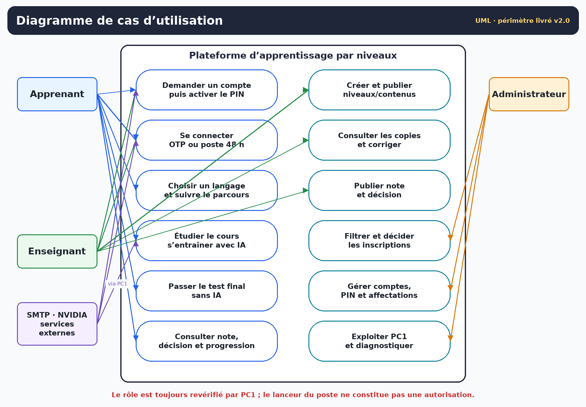

Lecture pour la soutenance :

- Les trois acteurs humains ont un compte avec **un seul rôle serveur**. Le nom du lanceur (PC2, PC3, PC4) ne suffit pas à autoriser une action.
- SMTP et NVIDIA sont des acteurs externes sollicités uniquement par PC1.
- Le bot de tri n’apparaît pas comme un utilisateur : c’est une règle serveur dans le cas d’inscription. Il ne pré-accepte jamais un enseignant.
- Le cas « Passer le test final » ne produit pas de note ; il produit une copie `SOUMISE`. Le cas enseignant « Publier note et décision » est celui qui peut faire progresser l’apprenant.

<!-- pagebreak -->

# 2. Modèle de données — identité et administration

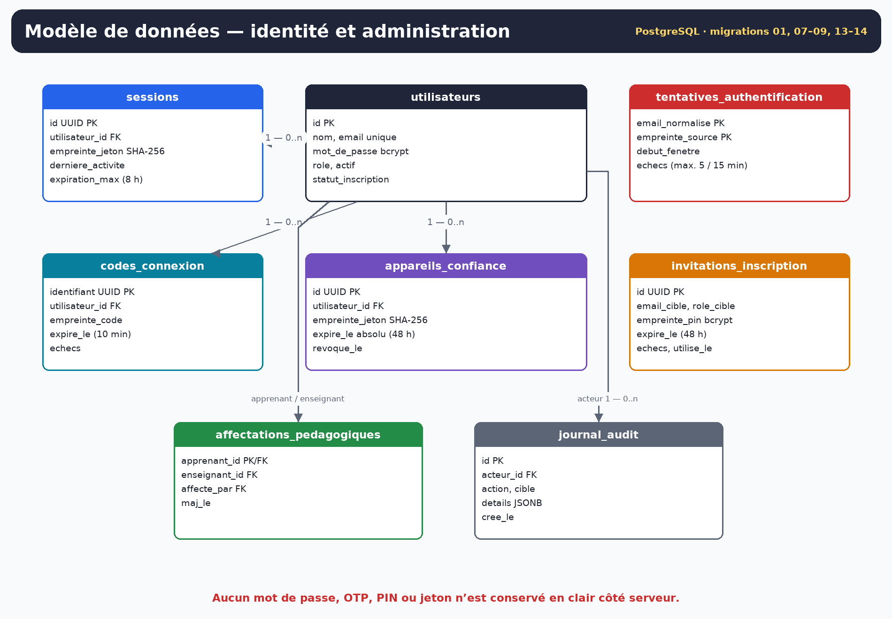

Décisions importantes :

- `utilisateurs.actif` et `utilisateurs.statut_inscription` sont indépendants : un compte peut être accepté mais encore inactif avant PIN.
- `sessions.empreinte_jeton`, `codes_connexion.empreinte_code` et `appareils_confiance.empreinte_jeton` ne contiennent pas les secrets présentés par le client.
- Le PIN est conservé sous forme d’empreinte bcrypt dans `invitations_inscription`.
- `tentatives_authentification` porte la fenêtre de limitation par e-mail normalisé et empreinte de source.
- `affectations_pedagogiques.apprenant_id` est la clé primaire : un apprenant a au plus un enseignant responsable actif dans le modèle livré.

<!-- pagebreak -->

# 3. Modèle de données — pédagogie et progression

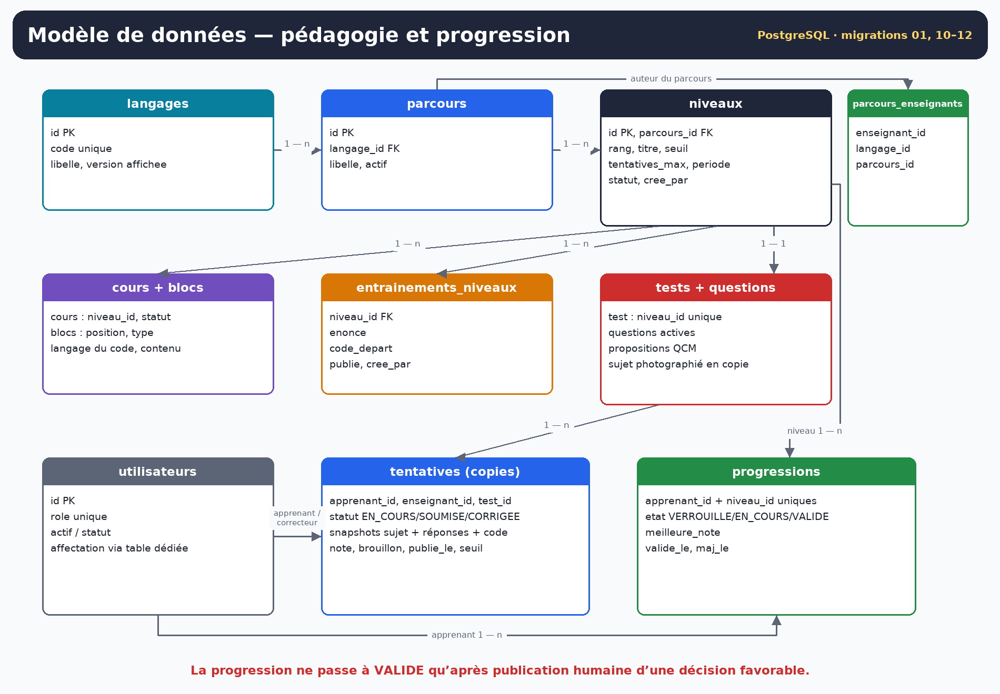

Décisions importantes :

- Un parcours appartient à un langage ; `parcours_enseignants` associe les nouveaux parcours à leur auteur.
- Un niveau publié possède un cours, un entraînement et un test. Les questions inactives ne sont pas proposées aux nouvelles copies.
- `tentatives` représente la copie et photographie le sujet, les réponses, le code et le seuil au moment du test.
- Les champs de brouillon de correction restent privés jusqu’à `publie_le`.
- `progressions` ne doit passer à `VALIDE` qu’après publication favorable ; un déclencheur protège une validation acquise.
- Les anciennes tables et colonnes d’exécution ou d’agent IA issues du schéma initial ne prouvent pas qu’un bac à sable est actif dans le parcours connecté.

<!-- pagebreak -->

# 4. Diagrammes d’états-transitions

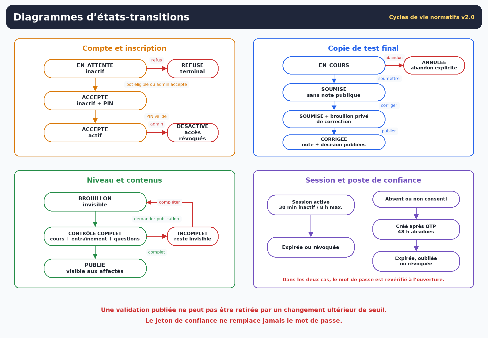

## 4.1 Compte

`EN_ATTENTE + inactif` est l’état de toute demande publique. L’acceptation du bot ou de l’administrateur crée un PIN mais ne rend pas le compte actif. Seule la saisie correcte du PIN avant expiration active le compte. Un refus est terminal pour la demande ; une désactivation ultérieure bloque les sessions et révoque les postes de confiance.

## 4.2 Copie

`EN_COURS` peut être reprise ou explicitement abandonnée. `SOUMISE` fige la copie côté apprenant. `CORRIGEE` n’est atteint qu’à la publication de l’enseignant. Aucun état intermédiaire ne doit exposer la note ou la décision du brouillon.

## 4.3 Contenus et session

Un niveau de l’enseignant naît en brouillon et n’est visible qu’après publication complète. Une session vit au plus 8 h et 30 minutes sans activité. La confiance est un enregistrement distinct, à expiration absolue de 48 h.

<!-- pagebreak -->

# 5. Séquence — inscription, décision et activation

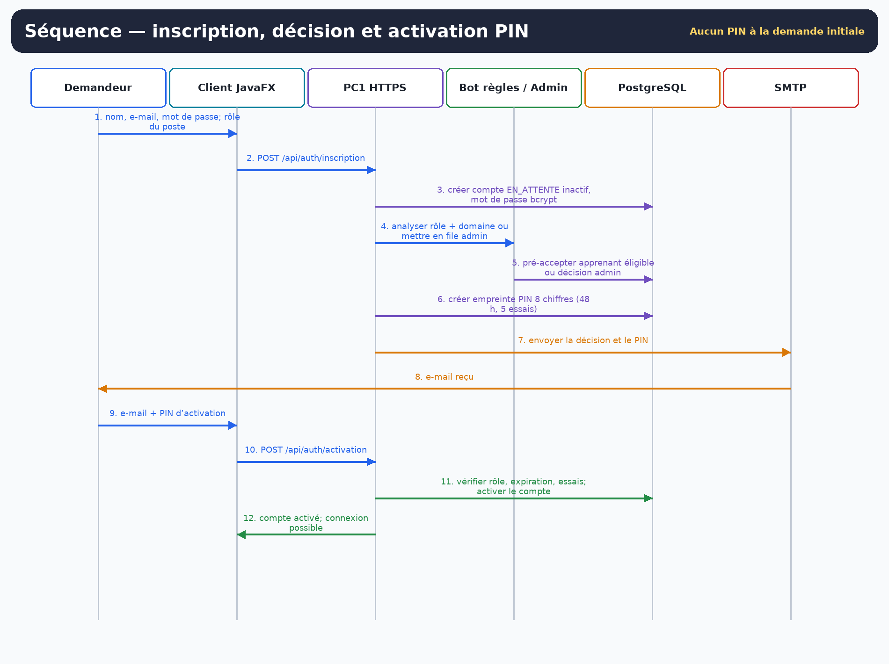

Points de contrôle :

1. La demande initiale ne contient pas de PIN.
2. Le bot ne lit que le rôle et le domaine ; l’administrateur traite les enseignants et exceptions.
3. L’acceptation et la création du PIN sont journalisées ; l’e-mail est envoyé ensuite.
4. Un échec SMTP ne doit pas faire croire que la décision n’existe pas : l’administrateur peut renvoyer le PIN.
5. L’activation vérifie également que le rôle du compte correspond au poste utilisé.

<!-- pagebreak -->

# 6. Séquence — connexion, OTP et confiance 48 h

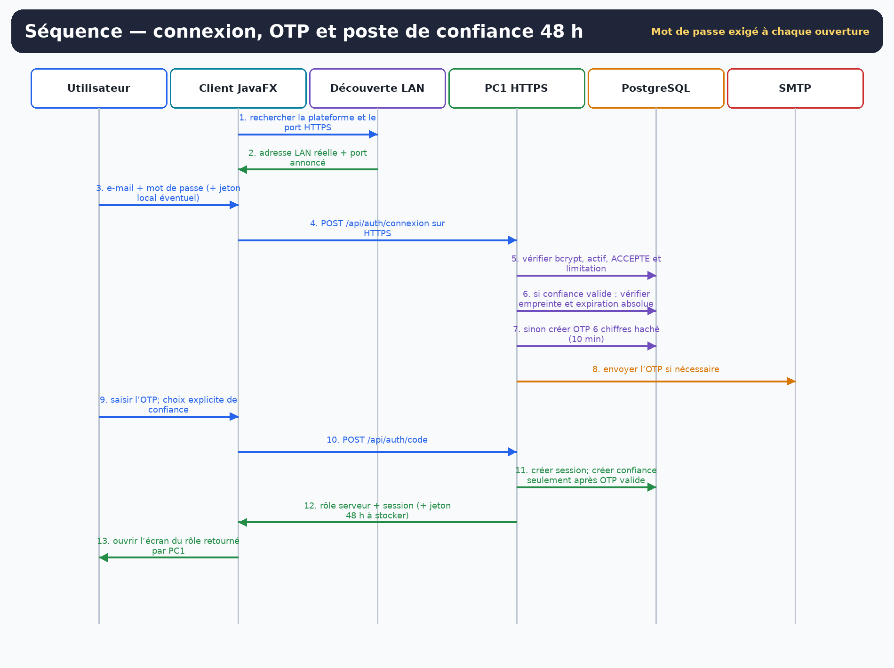

La confiance n’est pas une session permanente :

- le mot de passe est revérifié à chaque ouverture ;
- les échecs restent limités ;
- le compte doit rester actif et accepté ;
- l’expiration n’est jamais prolongée par l’usage ;
- fermer l’application révoque la session mais conserve le jeton local jusqu’à oubli, révocation ou échéance.

La découverte fournit une adresse et un port, jamais une identité de confiance. Le certificat HTTPS et le rôle retourné par PC1 restent les références.

<!-- pagebreak -->

# 7. Séquence — test final et correction humaine

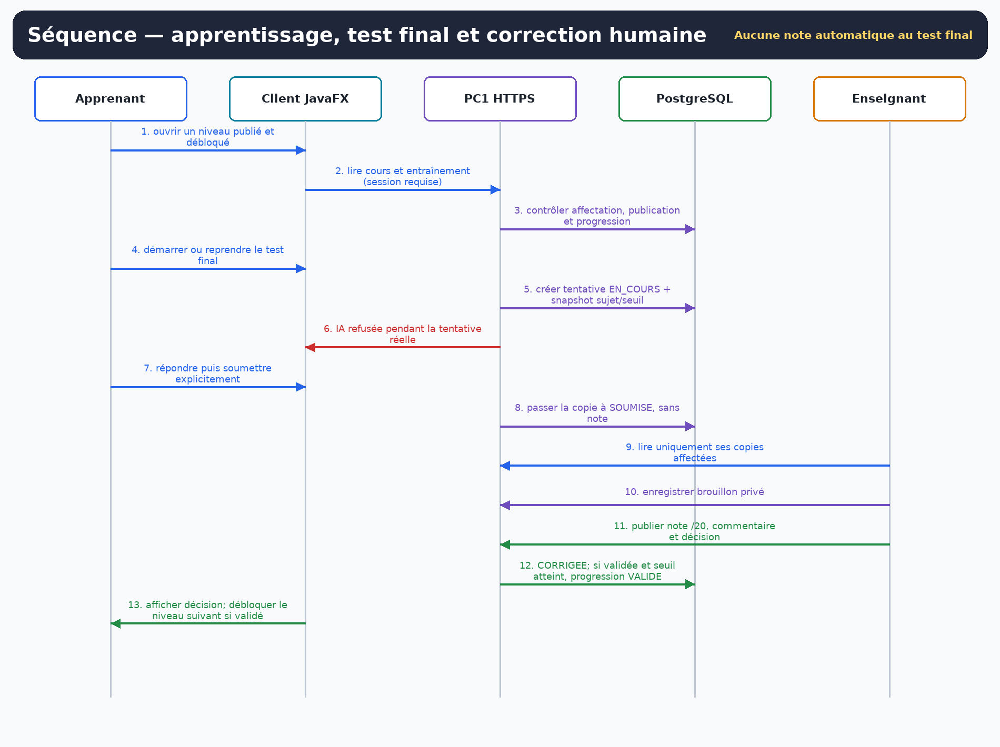

Cette séquence remplace l’ancien scénario de correction automatique :

- le serveur crée la tentative et photographie le seuil ;
- le client ne reçoit ni corrigé ni score ;
- `SOUMISE` signifie « en attente de l’enseignant », pas « réussie » ;
- le brouillon de l’enseignant n’est pas visible ;
- la publication est l’événement qui rend la décision visible et met à jour la progression.

<!-- pagebreak -->

# 8. Séquence — aide IA en entraînement

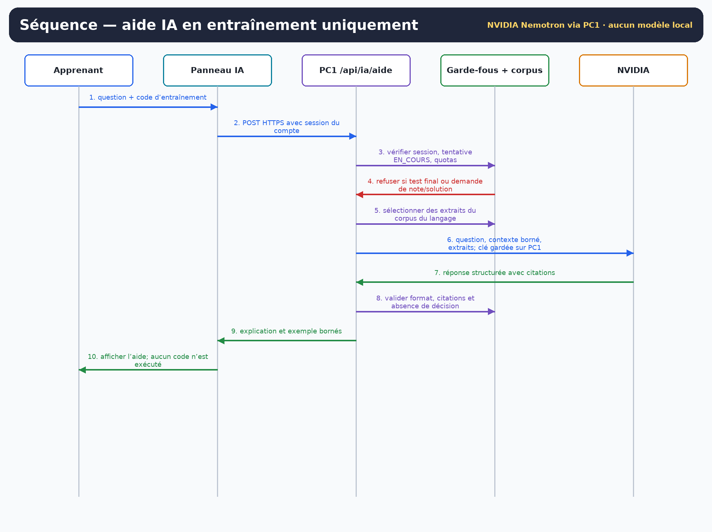

Le connecteur NVIDIA est installé uniquement dans le service HTTPS PC1. La clé fournisseur ne transite pas par les clients. Les quotas actuels sont de 30 demandes par compte et par jour et 200 appels admissibles partagés par jour, avec une requête à la fois. La réponse doit être structurée, bornée et citer les extraits transmis ; une citation inventée est rejetée.

Si une tentative finale réelle est `EN_COURS`, PC1 refuse l’aide, même si le panneau est ouvert dans une autre fenêtre du même compte.

<!-- pagebreak -->

# 9. Activité — progression complète

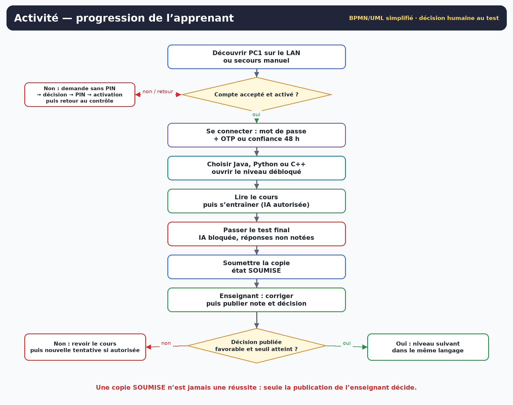

La boucle pédagogique est volontairement asymétrique :

- l’entraînement peut être répété et assisté ;
- le test final est sans IA ;
- l’échec publié renvoie à la révision et à une nouvelle tentative si le quota le permet ;
- seule une décision favorable publiée, avec note au moins égale au seuil photographié, ouvre le rang suivant dans le même langage.

<!-- pagebreak -->

# 10. Composants — architecture applicative

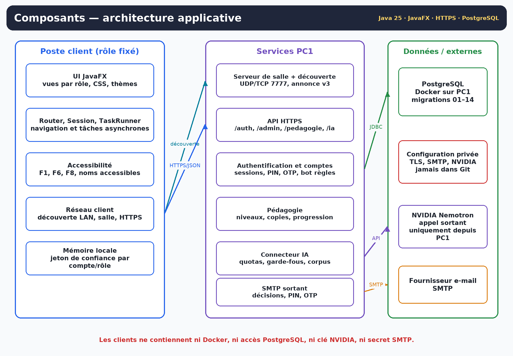

Correspondance avec le code :

| Zone | Paquetages / classes représentatifs |
|---|---|
| Interface | `fr.ihm2026.ui.admin`, `ui.enseignant`, `ui.apprenant`, `ui.commun`, `ui.ia` |
| Noyau client | `Router`, `Session`, `TaskRunner`, `Animations`, `ThemeManager`, `Accessibilite` |
| Réseau | `DecouverteServeurs`, `ClientReseau`, `ServeurLocal`, `MemoireAppareilConfiance` |
| API PC1 | `AuthentificationApiHttps`, `AdminApi`, `AideIaApi`, `BotInscription`, `ServiceEmail` |
| Persistance | `PostgresAuthentificationService`, `PostgresCompteRepository`, `PostgresPedagogieRepository` |
| IA | `ModeleNvidia`, corpus, prompts `system-v2`, garde-fous d’entrée/sortie |

Les écrans historiques adossés au mock ne font pas partie du chemin d’autorité : dès qu’une session réelle est installée, PC1 et PostgreSQL font foi pour les comptes et la pédagogie connectée.

<!-- pagebreak -->

# 11. Déploiement — PC1 et postes clients

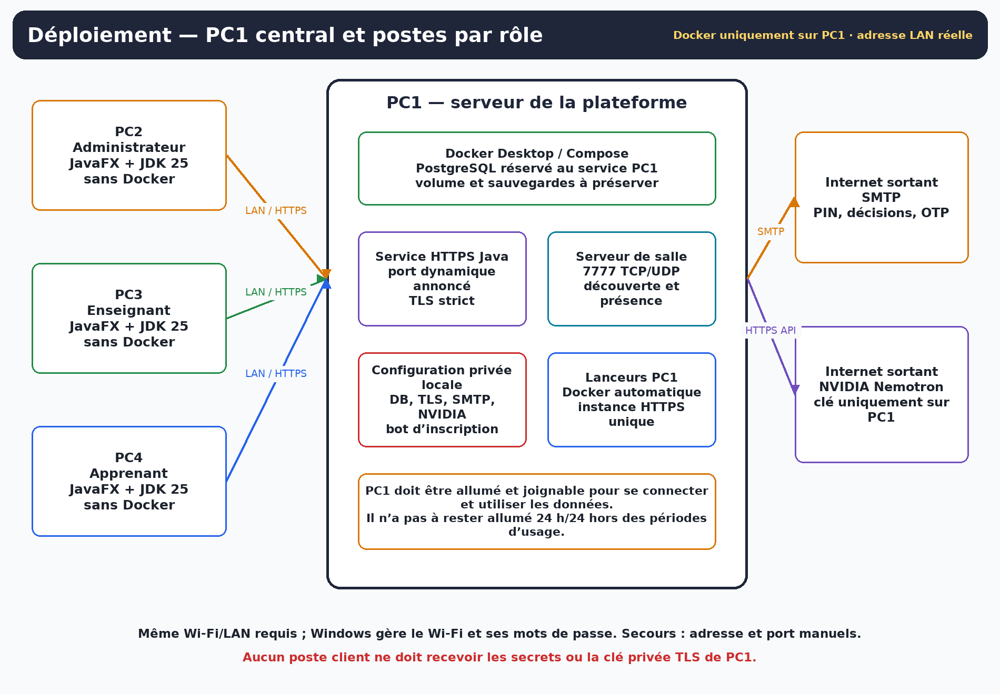

Règles de déploiement :

- Docker et PostgreSQL uniquement sur PC1 ; aucun client n’ouvre JDBC directement.
- Le serveur de salle conserve un point de rendez-vous configurable, 7777 par défaut.
- Le service HTTPS peut recevoir un port libre du système ; la découverte annonce le port réel.
- Le mode TLS automatique est opt-in : la CA privée reste sur PC1, seul son certificat public est approuvé sur les clients.
- PC1 n’a pas à fonctionner 24 h/24, mais il doit être allumé et joignable pour toute connexion ou lecture de données.
- Les migrations sur une base existante se font après sauvegarde, service HTTPS arrêté, sans suppression de volume.

# 12. Conventions et checklist de soutenance

## 12.1 Conventions

- Les flèches de séquence numérotées indiquent l’ordre logique, pas nécessairement un aller-retour HTTP par message de base de données.
- Les couleurs différencient les responsabilités, mais les libellés portent toujours le sens.
- Les états en majuscules reprennent les valeurs SQL ou métier ; les libellés français sont ceux présentés à l’utilisateur.
- Les relations de données montrent les clés structurantes, pas toutes les colonnes historiques ou techniques.

## 12.2 Phrases de défense

1. **Pourquoi PC1 ?** Pour que le rôle, les comptes, les copies et la progression soient décidés au même endroit, pas par un client modifiable.
2. **Pourquoi deux codes ?** Le PIN prouve l’activation après décision ; l’OTP prouve la possession récente de la boîte e-mail à la connexion.
3. **Pourquoi la confiance 48 h ne supprime-t-elle pas le mot de passe ?** Parce qu’elle remplace seulement la preuve e-mail récente ; l’identité par secret reste vérifiée à chaque ouverture.
4. **Comment éviter 100 000 décisions manuelles ?** Par un bot de règles limité aux apprenants, une file SQL filtrée et des lots, sans confier les enseignants à l’automatisation.
5. **Qui valide un niveau ?** L’enseignant publie la note et la décision ; le serveur applique ensuite le seuil photographié et la progression.
6. **Où est l’IA ?** Sur PC1, vers NVIDIA, uniquement pour l’entraînement ; elle est bloquée au test et ne débloque rien.
7. **Quelle limite assumer ?** Pas d’exécution de code dans le parcours connecté, pas de preuve de charge à grande échelle et recette NVDA/Windows encore à consigner.
