<!-- title: Maquettes basse fidélité — Croquis papier et Wireframes -->
<!-- subtitle: Conception IHM complète en français : cinématique globale, écrans par rôle (PC1–PC4), assistant IA et accessibilité -->
<!-- short: Maquettes basse fidélité -->
<!-- version: Version 2.0 -->
<!-- date: 10 novembre 2026 -->
<!-- baseline: Application 0.14.4 · branche main après PR #31 (2ae972b) -->
<!-- status: Livrable de conception basse fidélité (croquis papier + wireframes) -->

# 1. Démarche et objectif des maquettes basse fidélité

Ce document rassemble l’ensemble des **maquettes basse fidélité** de la *Plateforme intelligente d’apprentissage* (Java / JavaFX 25, architecture PC1–PC4, version applicative `0.14.4`). Conformément aux pratiques de génie IHM, la conception graphique a été séparée de la validation fonctionnelle en deux niveaux complémentaires pour chaque écran :

1. **Croquis papier (*paper prototypes*)** — Représentation volontairement manuscrite sur grille quadrillée, centrée sur l’exploration spatiale, le regroupement sémantique des actions, l’identification des points de rupture et la validation des règles métier sans distraction visuelle.
2. **Wireframes filaires (*low-fidelity wireframes*)** — Représentation schématique en niveaux de gris centrée sur la hiérarchie typographique, les libellés français exacts, l’ordre de tabulation clavier, les états vides/erreurs/chargement et la densité d’information avant toute stylisation JavaFX haute fidélité.

> Ces planches sont des artefacts de conception basse fidélité générés à partir de l’analyse des besoins v2.0, des modèles de tâches HTA v2.0 et des vues JavaFX existantes ; elles ne remplacent ni les captures d’exécution sous Windows ni la recette manuelle sur poste réel.

# 2. Inventaire des 12 planches et lecture des annotations

Chaque planche associe le **croquis papier** (dossier `docs/maquettes/croquis-papier/`) et son **wireframe filaire** (`docs/maquettes/wireframes/`), disponibles en formats vectoriel (`SVG`) et haute résolution (`PNG`, `1560 × 1000` pixels). Des repères numérotés (`1` à `5`) relient directement les composants d’interface aux règles métier et tâches HTA.

| Planche | Intitulé | Rôle / Poste | Tâches HTA | Vue(s) JavaFX associée(s) |
|---|---|---|---|---|
| `00` | Cinématique globale des écrans (Storyboard) | Tous (`PC1`–`PC4`) | `A0`–`UX1` | `App`, `Router`, flux global |
| `01` | Connexion, découverte PC1 & confiance 48 h | Apprenant / Ens. / Admin | `A0` | `VueConnexionServeur`, `LoginView` |
| `02` | Demande de compte, activation PIN & MDP oublié | Apprenant / Ens. | `A1` | `VueConnexionServeur` (modes dynamiques) |
| `03` | Apprenant : Mon parcours par niveaux | Apprenant (`PC4`) | `A2`, `A4` | `ParcoursServeurView`, `BarreLaterale` |
| `04` | Apprenant : Lecture du cours & Assistant IA | Apprenant (`PC4`) | `A2`, `IA1` | `ContenuNiveauView`, `PanneauAssistant` |
| `05` | Apprenant : Entraînement & Assistant IA | Apprenant (`PC4`) | `A2`, `IA1` | `ContenuNiveauView`, `PanneauAssistant` |
| `06` | Apprenant : Test final sans IA | Apprenant (`PC4`) | `A3` | `TestServeurView` |
| `07` | Apprenant : Mes copies & Tableau de bord | Apprenant (`PC4`) | `A4` | `ResultatView`, `SuiviPedagogique`, `TableauBordView` |
| `08` | Enseignant : Mes niveaux et contenus | Enseignant (`PC3`) | `E1` | `GestionNiveauxView` (+ 3 modales) |
| `09` | Enseignant : Mes apprenants et corrections | Enseignant (`PC3`) | `E2` | `ResultatsView`, `SuiviPedagogique` |
| `10` | Administrateur : Comptes, filtres & affectations | Administrateur (`PC2`) | `AD1` | `ComptesView` (+ modales) |
| `11` | Transversal : Barre réduite, accessibilité & états | Tous (`PC2`–`PC4`) | `UX1` | `BarreTitre`, `BarreLaterale`, `Accessibilite` |

<!-- pagebreak -->

# 3. Planche 00 — Cinématique globale des écrans (Storyboard)

| Rôle(s) / Poste(s) | Tâches HTA | Vues JavaFX & Composants | Exigences clés |
|---|---|---|---|
| Tous (`PC1`, `PC2`, `PC3`, `PC4`) | `A0` → `A1` → `A2`/`A3`/`A4` · `E1`/`E2` · `AD1` · `IA1` · `UX1` | `App`, `Router`, `BarreTitre`, `BarreLaterale` | `RG-01`, `RG-02`, `RG-04`, `RG-19`, `RG-20` |

**Cinématique :** L’entrée s’effectue sur un poste pré-configuré par rôle qui découvre `PC1` sur le réseau local, puis authentifie l’utilisateur via e-mail, mot de passe et preuve `OTP`/`confiance 48 h`. Le serveur vérifie le rôle du compte et route vers la session Apprenant (`E03`–`E07`), Enseignant (`E08`–`E09`) ou Administrateur (`E10`), avec séparation stricte entre l’entraînement assisté par IA (`E05`) et le test final où l’IA est bloquée côté serveur (`E06`).

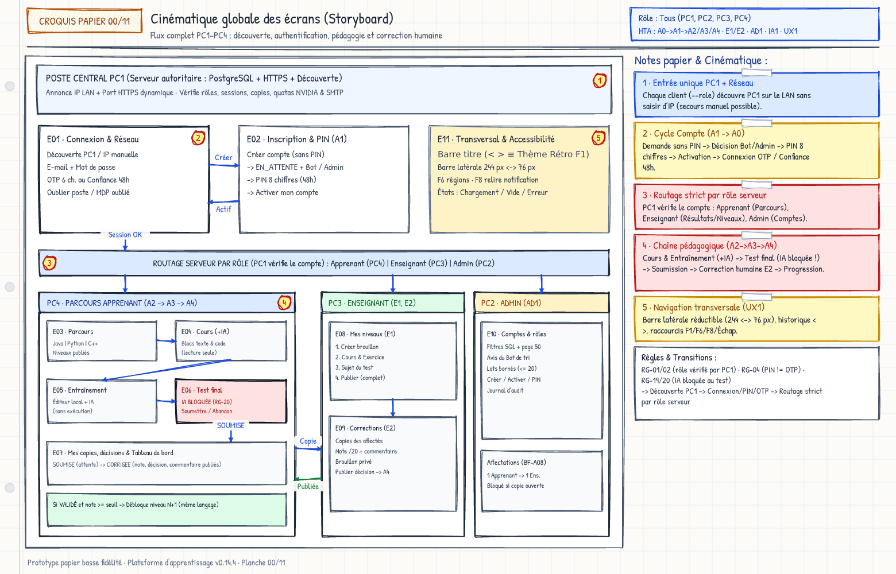

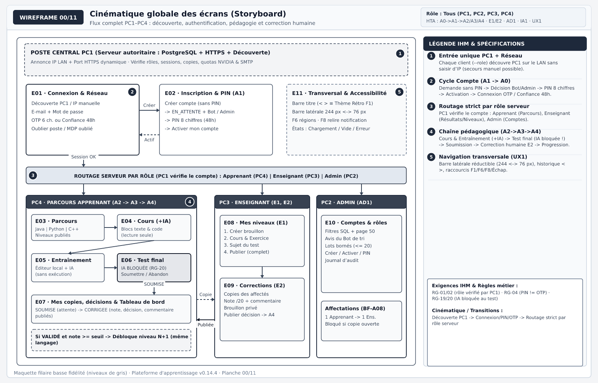

<!-- pagebreak -->

# 4. Planche 01 — Connexion, découverte PC1 & confiance 48 h

| Rôle(s) / Poste(s) | Tâches HTA | Vue JavaFX & Composants | Exigences clés |
|---|---|---|---|
| Apprenant, Enseignant, Administrateur (selon lanceur) | `A0` (Découvrir PC1 et ouvrir une session) | `VueConnexionServeur`, `LoginView` (cas poste non configuré) | `IHM-01`..`IHM-05`, `IHM-09`, `RG-02`, `RG-06`..`RG-08` |

**Transitions :** Clic Wi-Fi → popup *Paramètres réseau* (`Réessayer`, `Wi-Fi Windows`, saisie manuelle `IP:Port`). Connexion réussie → accueil du rôle serveur. Liens inférieurs → *Créer un compte* / *Activer avec le PIN* (Planche `02`) ou *Mot de passe oublié*. Si l’application est lancée sans argument `--role=...`, `LoginView` affiche une carte d’erreur orientant vers les lanceurs `postes\2/3/4-*.bat`.

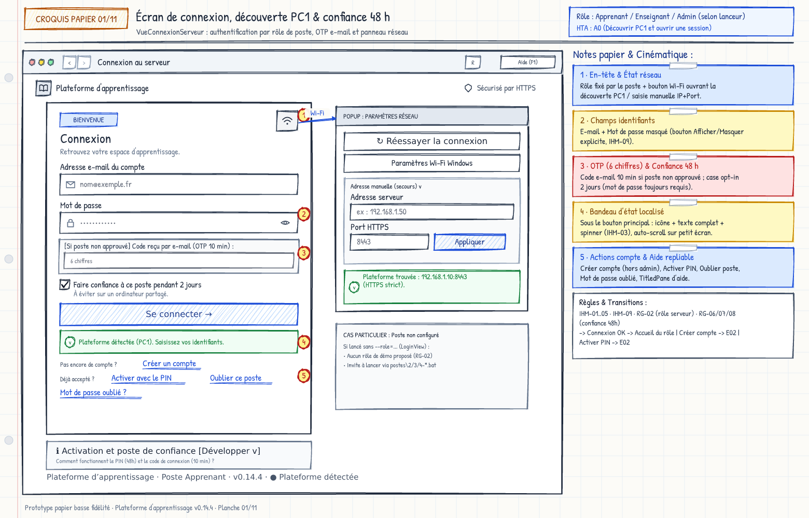

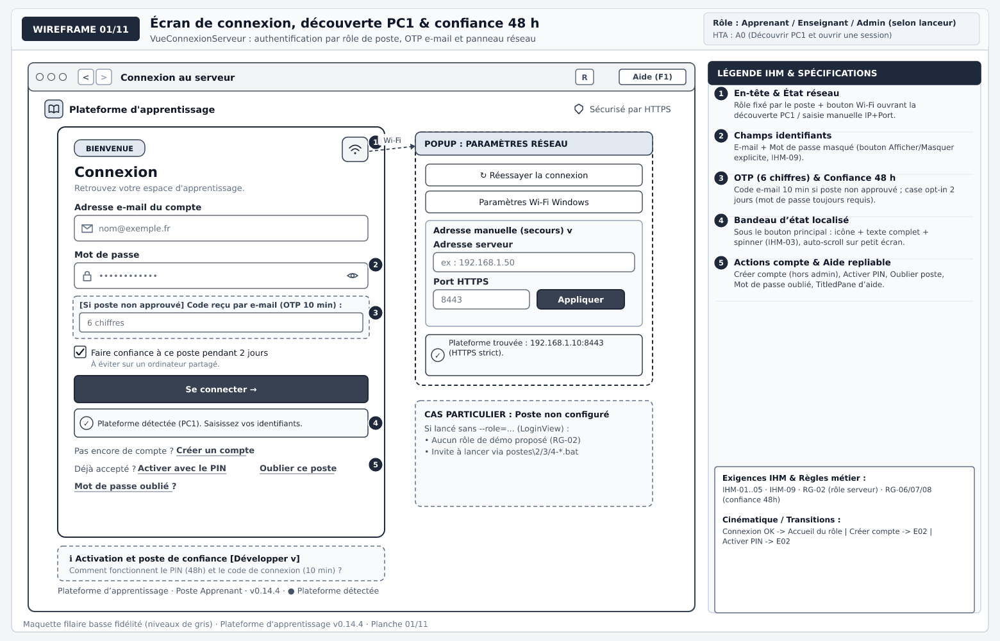

<!-- pagebreak -->

# 5. Planche 02 — Demande de compte & Activation par PIN

| Rôle(s) / Poste(s) | Tâches HTA | Vue JavaFX & Composants | Exigences clés |
|---|---|---|---|
| Demandeur Apprenant ou Enseignant (hors PC2 Admin) | `A1` (Demander un compte et l’activer) | `VueConnexionServeur` (modes Inscription, Activation, dialogue MDP) | `BF-U01`..`BF-U04`, `RG-03`, `RG-04`, `RG-06` |

**Transitions :** La création de compte n’exige aucun code PIN initial (`RG-03`) et place la demande en état `EN_ATTENTE` (pré-acceptation éventuelle pour apprenant ou revue administrateur). Une fois le PIN à 8 chiffres (valable 48 h, 5 essais maximum) reçu par e-mail, le mode *Activer mon compte* rend le compte actif sans ouvrir automatiquement de session, puis renvoie vers la connexion (`Planche 01`).

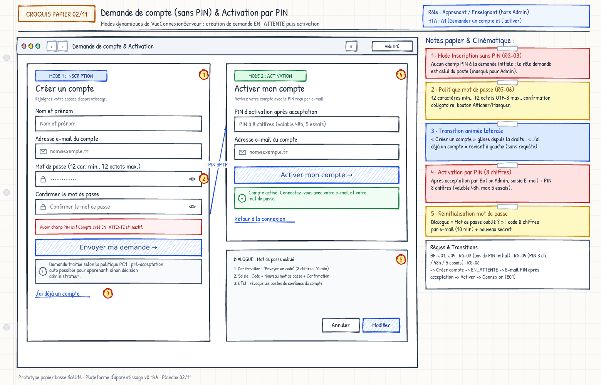

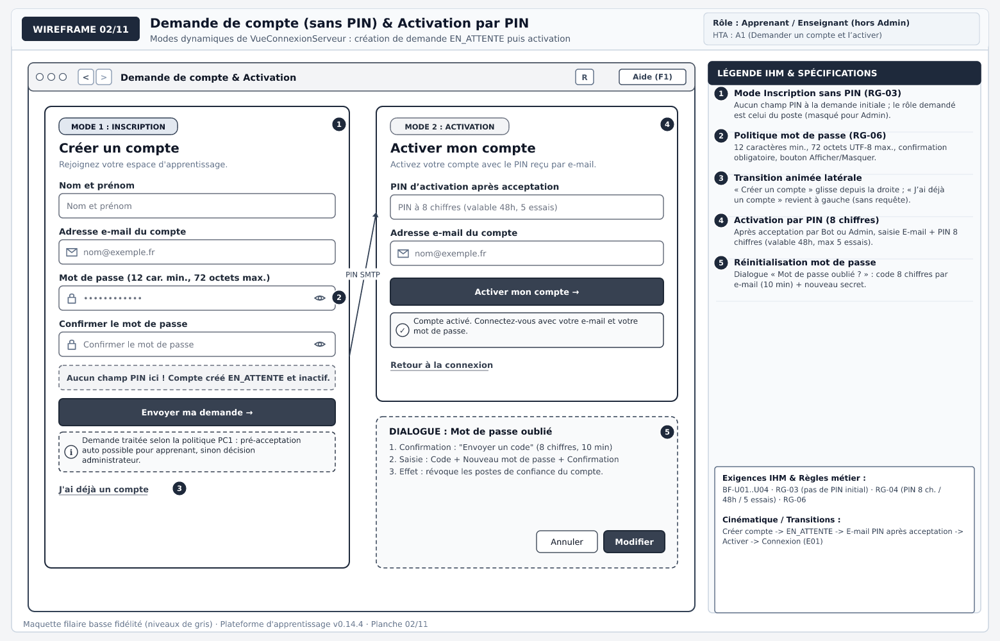

<!-- pagebreak -->

# 6. Planche 03 — Apprenant : Mon parcours par niveaux

| Rôle(s) / Poste(s) | Tâches HTA | Vue JavaFX & Composants | Exigences clés |
|---|---|---|---|
| Apprenant (`PC4`) | `A2`, `A4` (Choisir langage et niveau, suivre la progression) | `ParcoursServeurView`, `BarreLaterale` (`244 px`) | `BF-P01`, `BF-P06`, `BF-P09`, `IHM-06`, `IHM-07`, `IHM-10`, `IHM-11`, `RG-10`, `RG-11` |

**Transitions :** Le sélecteur latéral bascule de façon indépendante entre `Java`, `Python` et `C++` (`RG-11`). Chaque carte de niveau affiche explicitement son état (`VALIDE`, `EN_COURS`, `VERROUILLE`), sa meilleure note/seuil et l’état de préparation de chaque étape (*disponible* vs *en préparation*) : clic `1 · Cours` → Planche `04` ; `2 · Entraînement` → Planche `05` ; `3 · Test final` → Planche `06`.

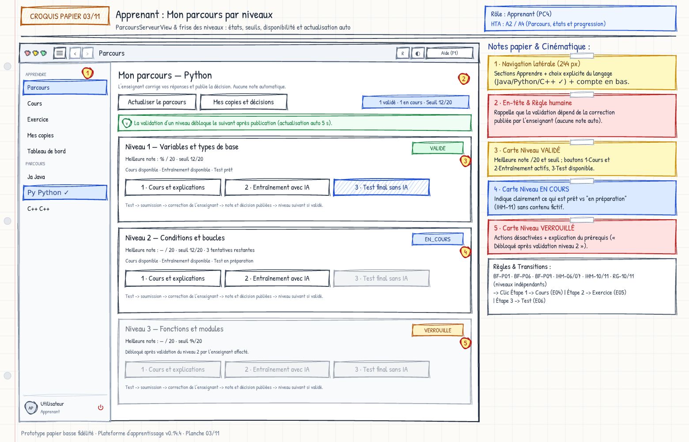

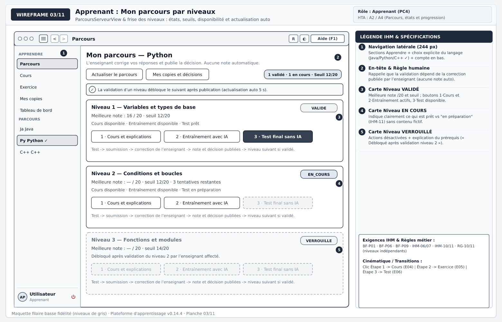

<!-- pagebreak -->

# 7. Planche 04 — Apprenant : Lecture du cours & Assistant IA

| Rôle(s) / Poste(s) | Tâches HTA | Vue JavaFX & Composants | Exigences clés |
|---|---|---|---|
| Apprenant (`PC4`) | `A2` (Étudier un cours) + `IA1` (Aide citée et bornée) | `ContenuNiveauView` (mode cours) + `PanneauAssistant` | `BF-P03`, `BF-P07`, `BF-IA01`..`BF-IA05`, `RG-19` |

**Transitions :** La zone gauche restitue les blocs de cours texte et code publiés sur `PC1` en lecture seule (aucune simulation d’exécution). Le panneau droit relaie l’assistant NVIDIA exclusivement via `PC1`, limite l’historique à trois tours, cite une section réelle du corpus (`-> Section`) et rappelle en permanence qu’il ne note ni ne valide. Actions basses : retour au parcours (`03`) ou poursuite vers l’entraînement (`05`).

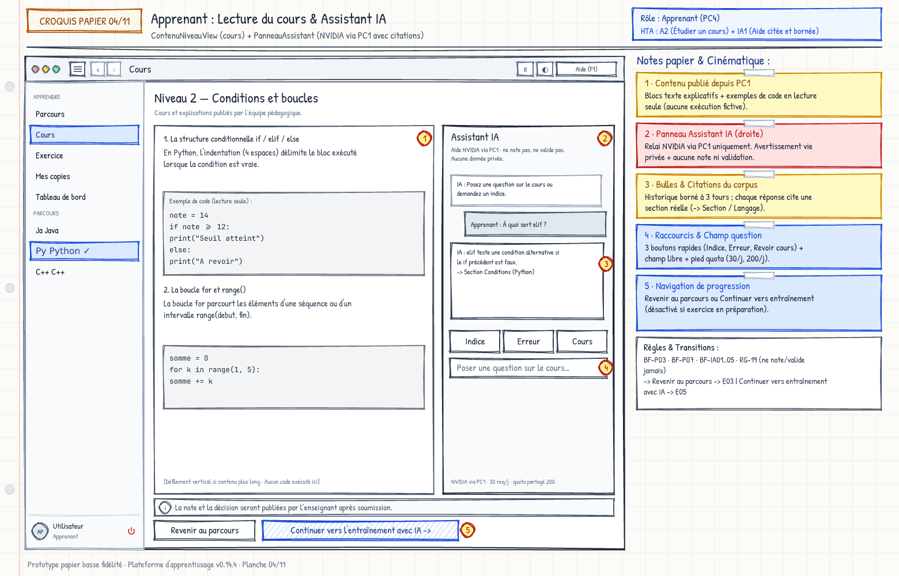

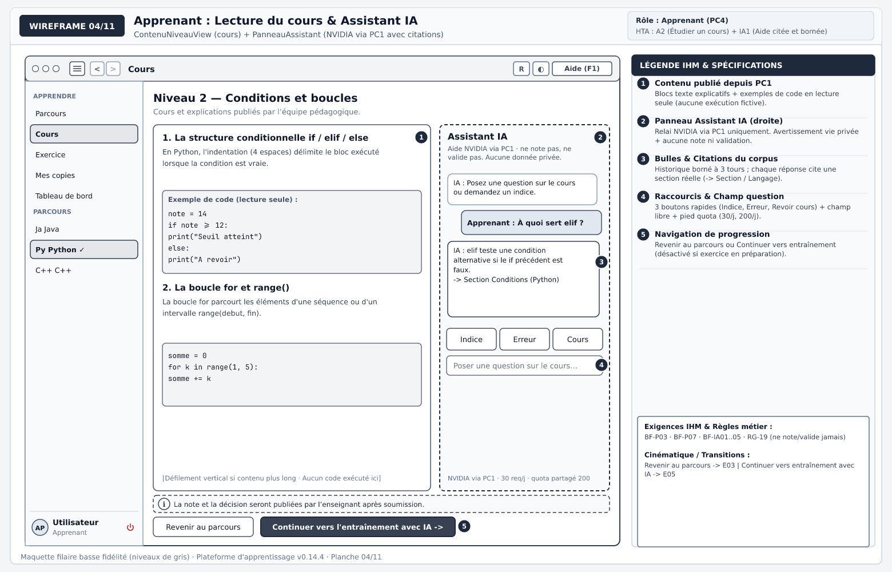

<!-- pagebreak -->

# 8. Planche 05 — Apprenant : Entraînement & Assistant IA

| Rôle(s) / Poste(s) | Tâches HTA | Vue JavaFX & Composants | Exigences clés |
|---|---|---|---|
| Apprenant (`PC4`) | `A2` (S’entraîner) + `IA1` (Expliquer le code courant) | `ContenuNiveauView` (mode exercice) + `PanneauAssistant` | `BF-P09`, `BF-IA05`, `BF-IA06`, `RG-21` |

**Transitions :** L’éditeur central est un brouillon local pré-rempli par le code de départ (`code_depart`) : conformément à `RG-21`, aucun faux bouton *Exécuter* ni aucune console fictive n’y figure. Le rafraîchissement automatique toutes les 5 secondes protège les modifications locales contre l’écrasement (`BF-P09`). Le panneau IA reçoit la question et le code courant ; le bouton principal bascule vers le test final sans IA (`06`).

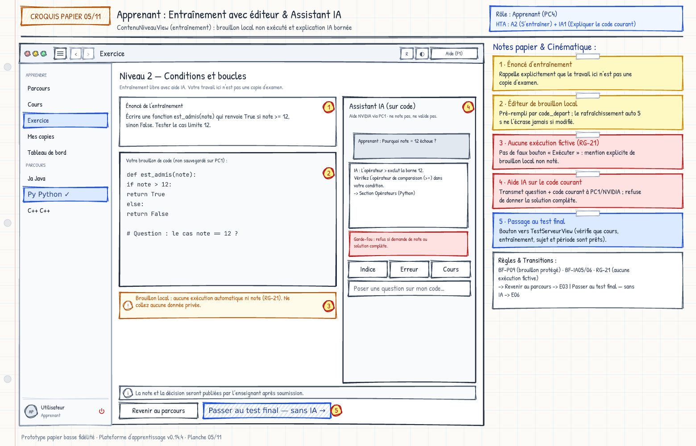

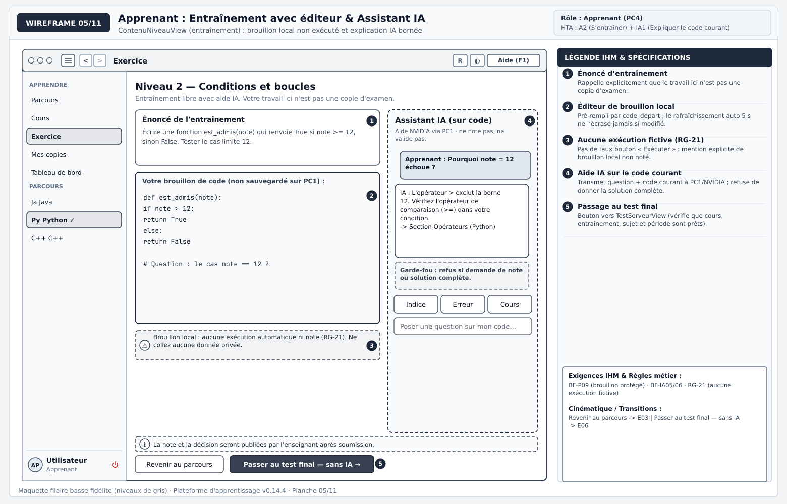

<!-- pagebreak -->

# 9. Planche 06 — Apprenant : Test final sans IA

| Rôle(s) / Poste(s) | Tâches HTA | Vue JavaFX & Composants | Exigences clés |
|---|---|---|---|
| Apprenant (`PC4`) | `A3` (Passer et soumettre le test final) | `TestServeurView` (+ dialogues de confirmation) | `BF-E01`..`BF-E04`, `BF-E10`, `RG-13`..`RG-15`, `RG-20`, `IHM-17` |

**Transitions :** Dès le démarrage d’une tentative réelle (`EN_COURS`), le panneau IA disparaît et `PC1` rejette toute requête `/api/ia/aide` pour l’ensemble du compte (`RG-20`). Le sujet et le seuil sont photographiés au lancement ; quitter l’écran préserve la copie en cours (`RG-14`). Deux sorties explicites avec confirmation modale existent : *Abandonner cette tentative* (`ANNULEE`) ou *Soumettre à mon enseignant* (`SOUMISE`, aucune note automatique) → Planche `07`.

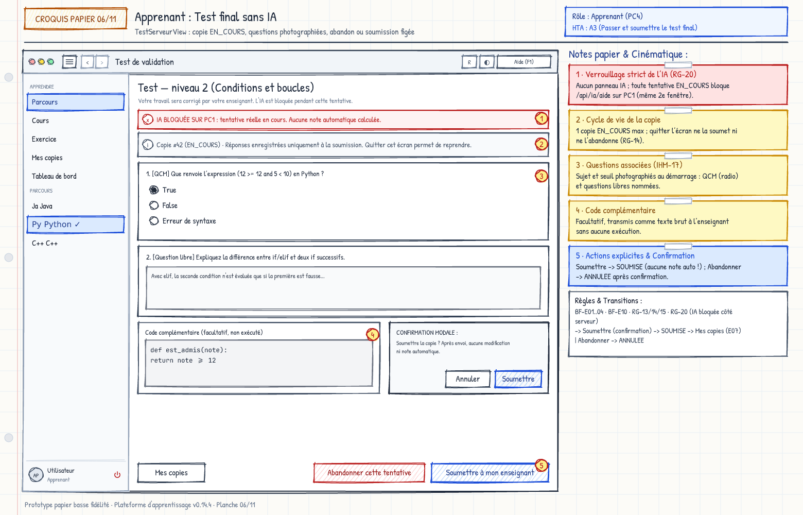

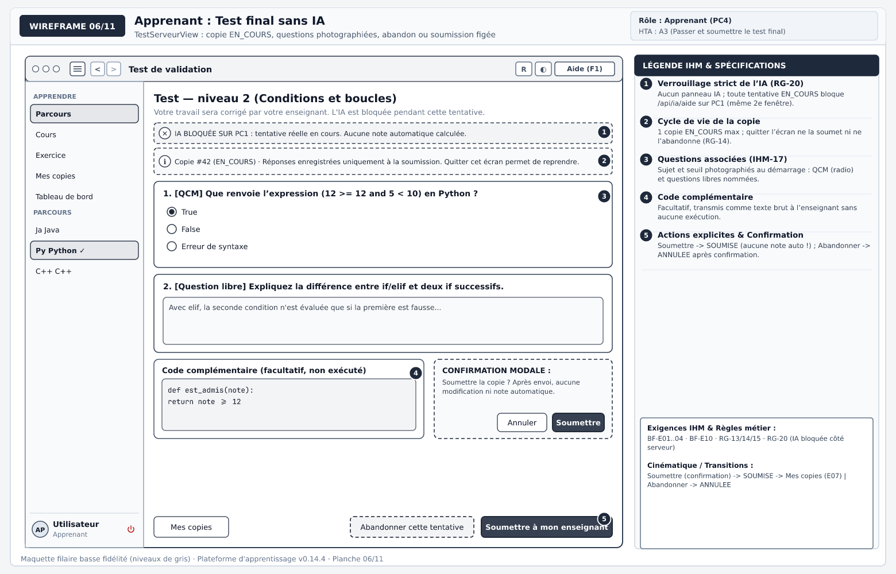

<!-- pagebreak -->

# 10. Planche 07 — Apprenant : Mes copies & Tableau de bord

| Rôle(s) / Poste(s) | Tâches HTA | Vue JavaFX & Composants | Exigences clés |
|---|---|---|---|
| Apprenant (`PC4`) | `A4` (Lire la décision et poursuivre) | `ResultatView` (`SuiviPedagogique(false)`) & `TableauBordView` | `BF-E04`, `BF-E08`, `BF-E09`, `RG-16`, `RG-18` |

**Transitions :** La vue supérieure liste les copies soumises : une copie `SOUMISE` masque strictement tout brouillon enseignant (`RG-16`), tandis qu’une copie `CORRIGEE` révèle la note publiée `/20`, la décision (*VALIDÉ* / *REFUSÉ*) et le commentaire. La vue inférieure (*Tableau de bord*) synthétise les indicateurs par langage (`Java` / `Python` / `C++`), expose *Ce qui vous bloque* et offre des liens directs vers *Revoir le cours* (`04`) ou *Repasser le test* (`06`).

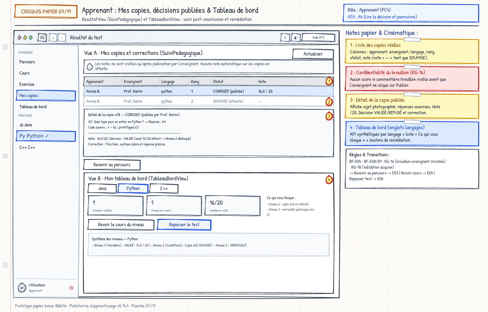

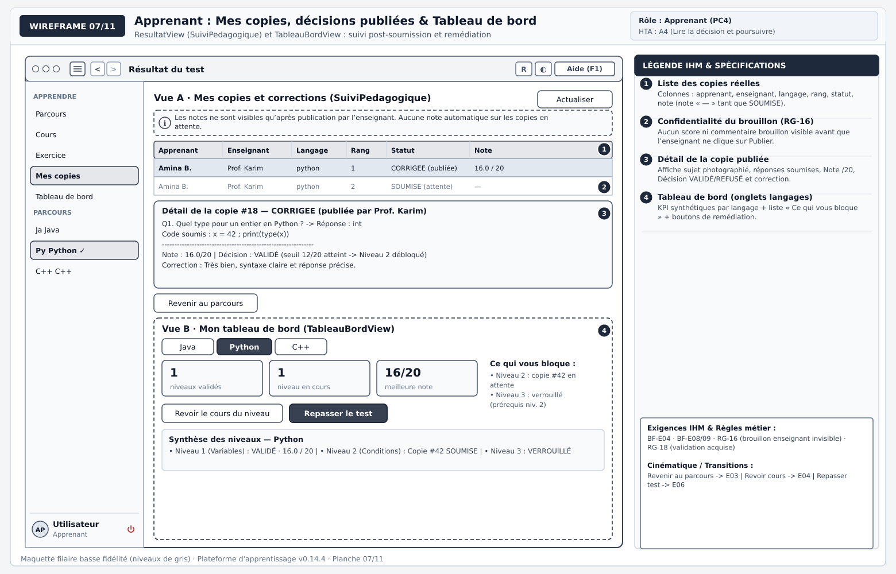

<!-- pagebreak -->

# 11. Planche 08 — Enseignant : Mes niveaux et contenus pédagogiques

| Rôle(s) / Poste(s) | Tâches HTA | Vue JavaFX & Composants | Exigences clés |
|---|---|---|---|
| Enseignant (`PC3`) | `E1` (Créer, préparer et publier un niveau) | `GestionNiveauxView` (+ 3 dialogues modaux) | `BF-P02`..`BF-P05`, `BF-P10`, `RG-09`, `RG-10`, `RG-12` |

**Transitions :** L’enseignant crée et publie ses propres niveaux de façon autonome sans dépendre de l’administrateur (`RG-12`), selon une barre en quatre étapes ordonnées : `1 · Créer` (`BROUILLON` invisible aux apprenants) → `2 · Publier cours & exercice` → `3 · Préparer test final` (1 à 20 questions libres, sans corrigé automatique) → `4 · Publier le niveau` (contrôlé par `PC1` : niveau `N-1` publié et contenu complet exigés).

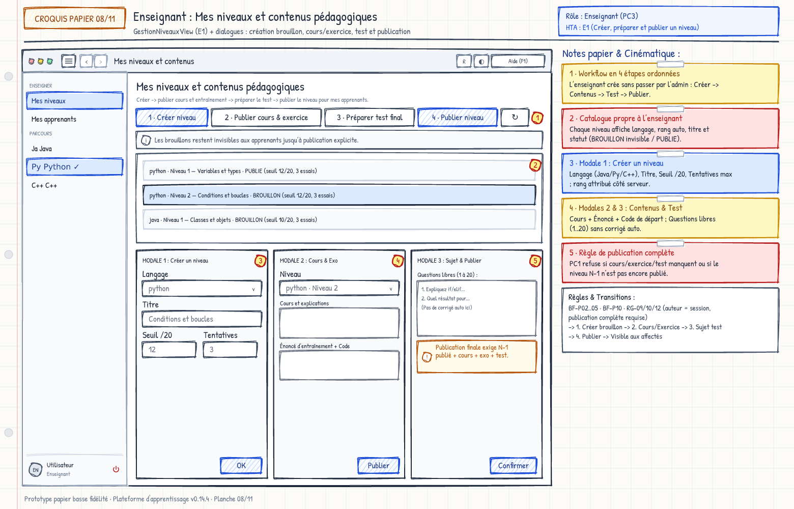

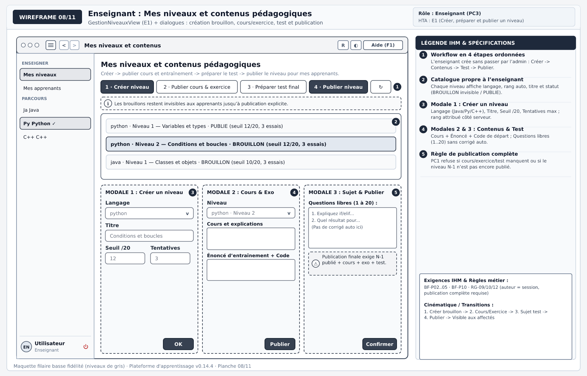

<!-- pagebreak -->

# 12. Planche 09 — Enseignant : Mes apprenants et corrections humaines

| Rôle(s) / Poste(s) | Tâches HTA | Vue JavaFX & Composants | Exigences clés |
|---|---|---|---|
| Enseignant (`PC3`) | `E2` (Corriger et publier une copie) | `ResultatsView`, `SuiviPedagogique(true)` | `BF-E05`..`BF-E09`, `RG-16`, `RG-17` |

**Transitions :** La vue affiche la liste des apprenants affectés (`BF-E05`) et leurs copies sur `PC1`. La sélection d’une copie `SOUMISE` charge à gauche le sujet et le code photographiés au moment du test, et active à droite le formulaire *Correction humaine* : saisie de note `/20`, commentaire obligatoire, validation conditionnée au seuil photographié (`RG-17`), sauvegarde de brouillon privé (`RG-16`) ou publication définitive après confirmation.

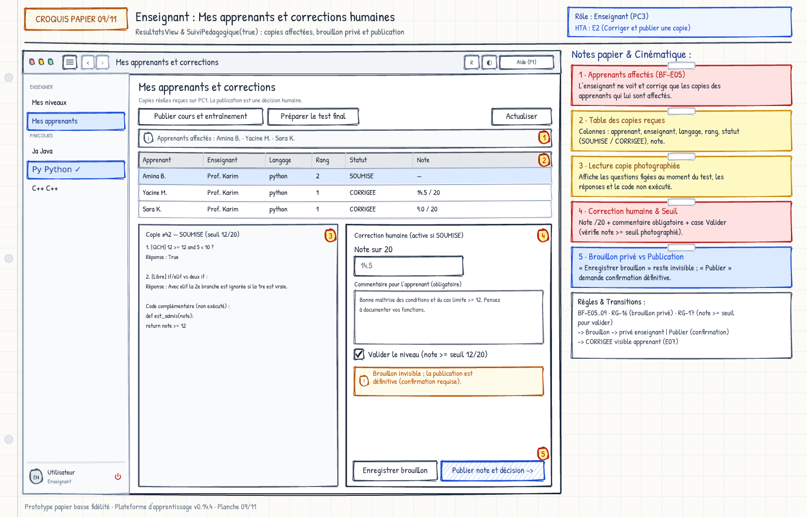

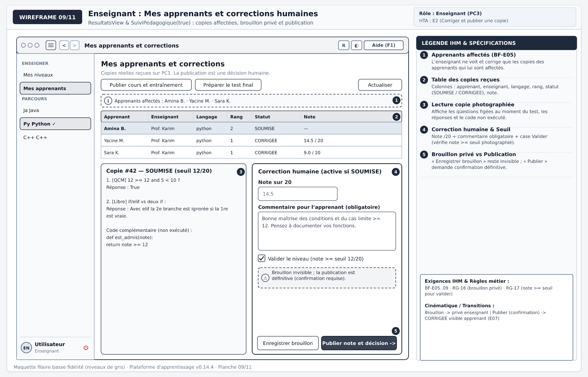

<!-- pagebreak -->

# 13. Planche 10 — Administrateur : Comptes, filtres & affectations

| Rôle(s) / Poste(s) | Tâches HTA | Vue JavaFX & Composants | Exigences clés |
|---|---|---|---|
| Administrateur (`PC2`) | `AD1` (Administrer demandes, comptes et affectations) | `ComptesView` (+ modales Création, Audit, Affectation) | `BF-A01`..`BF-A08`, `IHM-12`..`IHM-14`, `RG-01`, `RG-05` |

**Transitions :** Les compteurs SQL et la barre à 5 filtres pilotent une table paginée par 50 lignes incluant la colonne explicable *Avis du bot de tri* (qui ne pré-accepte jamais les enseignants, `RG-05`). Le bandeau d’état (`IHM-13`) distingue chargement, succès, vide filtré et erreur réseau avec conservation des lignes et bouton *Réessayer*. Les décisions par lots sont bornées à 20 éléments avec confirmation et rapport des échecs SMTP ; l’affectation associe un apprenant à un enseignant (bloquée si copie ouverte).

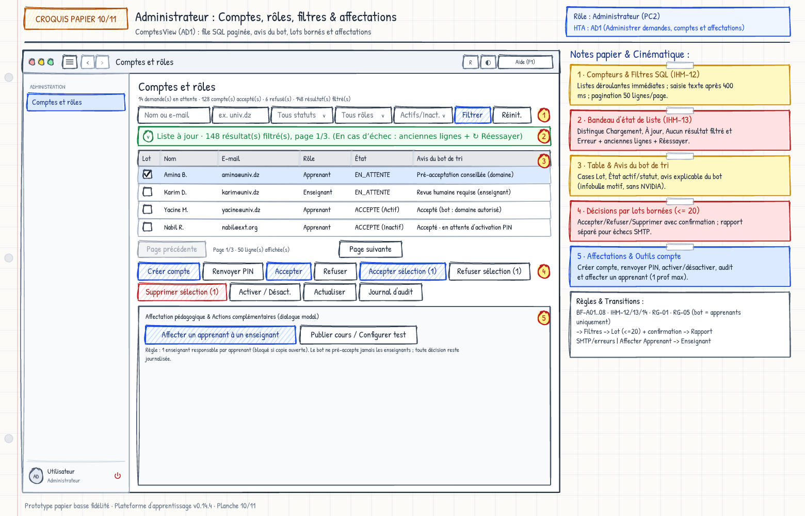

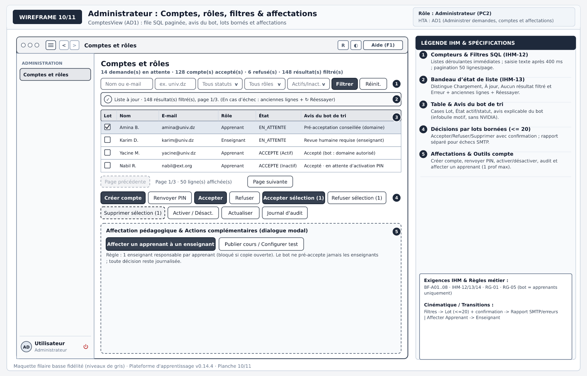

<!-- pagebreak -->

# 14. Planche 11 — Transversal : Barre latérale réduite, accessibilité & états

| Rôle(s) / Poste(s) | Tâches HTA | Vue JavaFX & Composants | Exigences clés |
|---|---|---|---|
| Tous (`PC2`, `PC3`, `PC4`) | `UX1` (Clavier, lecteur d’écran et compréhension des états) | `BarreTitre`, `BarreLaterale`, `Accessibilite` | `IHM-06`..`IHM-08`, `IHM-13`, `IHM-15`..`IHM-20`, `BNF-15` |

**Comportements garantis :** Le bouton hamburger supérieur réduit la barre latérale de `244 px` à un rail d’icônes de `76 px` en conservant info-bulles et noms accessibles (`IHM-06`). La touche `F6` / `Maj+F6` parcourt les trois régions de la fenêtre ; `F1` ouvre l’aide clavier ; `F8` relit la dernière notification ; `Échap` ferme les alertes (`UX1`). Enfin, les quatre états normalisés et les trois thèmes (*Clair*, *Sombre*, *Rétro*) conservent un ordre identique des commandes.

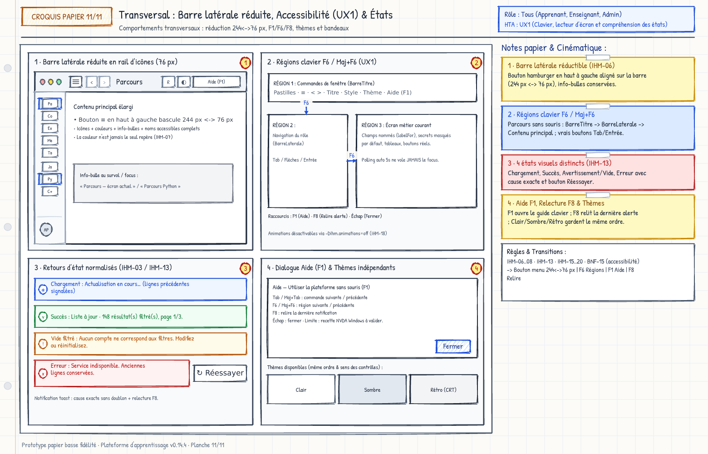

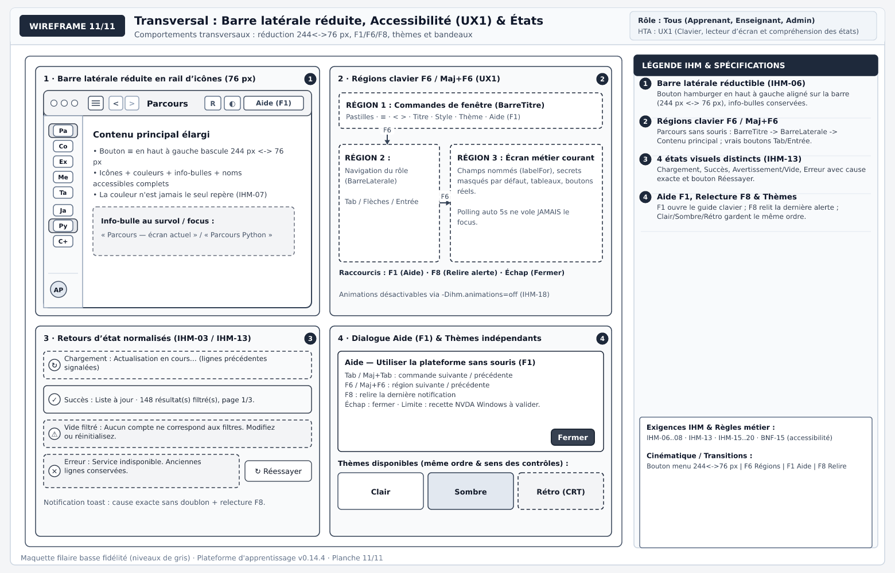

<!-- pagebreak -->

# 15. Matrice de traçabilité et limites de validation

## 15.1 Couverture des exigences IHM (IHM-01 à IHM-20)

| Exigences IHM | Planches associées | Élément maquette garantissant l’exigence |
|---|---|---|
| `IHM-01` à `IHM-05` | `01`, `02`, `11` | Bandeau d’état localisé sous le bouton principal, icônes distinctes, auto-scroll et relecture `F8` |
| `IHM-06` à `IHM-08` | `03`, `11` | Rail réduit `244 <-> 76 px`, étiquettes textuelles systématiques, thèmes sans altération d’ordre |
| `IHM-09` à `IHM-11` | `01`, `02`, `03` | Bouton Afficher/Masquer explicite, statut « en préparation » sans contenu fictif |
| `IHM-12` à `IHM-14` | `10`, `11` | Filtrage automatique sans bouton caché, bandeau d’état de liste et rapport de lot séparé |
| `IHM-15` à `IHM-20` | `06`, `09`, `11` | Champs nommés, zéro vol de focus au polling, régions `F6`, aide `F1`, animations désactivables |

## 15.2 Limites et recette à compléter sur postes réels

- **Croquis vs exécution JavaFX :** Ces 24 planches (12 croquis papier + 12 wireframes) valident la structure d’information, le vocabulaire français et les transitions d’écrans ; elles ne prouvent pas le rendu pixel final sous JavaFX 25 Windows.
- **Recette accessibilité Windows / NVDA (`BNF-15`) :** Les fondations clavier (`Tab`, `F1`, `F6`, `F8`, `Échap`) et les noms accessibles sont intégrés dans la conception et les vues Java ; aucune certification WCAG/RGAA complète ne peut être déclarée sans audit réel sous Windows avec NVDA (`docs/README.md`).
- **Régénération des livrables :** Les 24 planches (`SVG` et `PNG`) sont régénérables de manière déterministe via `node outils/generer_maquettes_bf.mjs`, et le présent document PDF via `python3 outils/generer_maquettes_pdf.py`.
