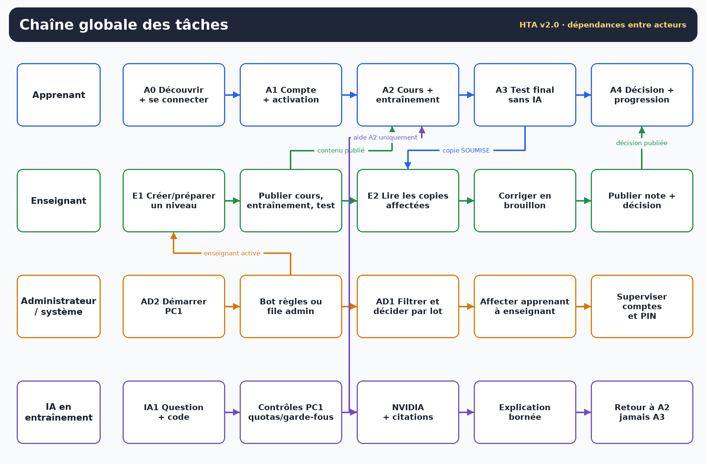

<!-- title: Modèles de tâches de la plateforme -->
<!-- subtitle: Analyse hiérarchique des tâches alignée sur les postes PC1 à PC4, la correction humaine et l’accessibilité -->
<!-- short: Modèles de tâches -->
<!-- version: Version 2.0 -->
<!-- date: 3 novembre 2026 -->
<!-- baseline: Application 0.14.4 · branche main après PR #31 (2ae972b) -->
<!-- status: Modèles HTA mis à jour selon le parcours livré -->

# 0. Ce qui change par rapport aux modèles v1

Les huit modèles v1 reposaient sur plusieurs hypothèses désormais remplacées :

| Ancien modèle v1 | Modèle v2.0 livré |
|---|---|
| Validation de l’e-mail par lien | Demande sans PIN, décision bot/admin, PIN d’activation, puis OTP de connexion distinct |
| Choix libre du rôle à l’inscription | Rôle fixé par le lanceur du poste et revérifié par le compte serveur |
| Test de positionnement à l’entrée | Aucun test de positionnement dans le parcours livré ; accès au niveau publié et débloqué |
| Correction automatique et déblocage par moteur | Test sans note automatique ; enseignant affecté corrige et publie ; PC1 applique seuil et progression |
| Exécution du code dans la boucle d’exercice | Brouillon de code non exécuté dans le parcours connecté ; l’IA peut l’expliquer en entraînement |
| IA en positionnements A/B à trancher | Assistant dans la session authentifiée, via PC1/NVIDIA ; bot d’inscription séparé et déterministe |
| Administration unitaire | File PostgreSQL filtrée automatiquement, pagination, avis du bot et lots bornés |
| Actualisation manuelle par l’apprenant | Vues connectées rafraîchies périodiquement, sans voler le focus |
| Erreur souvent en bas d’écran | Bandeaux près de l’action, cause exacte, anciennes données signalées et bouton Réessayer |

La v2.0 retient **onze tâches** : cinq côté apprenant, deux côté enseignant, deux côté administrateur/exploitant, une tâche IA et une tâche transversale d’accessibilité. La tâche A0 est séparée de A1 parce que la découverte du serveur, l’OTP et la confiance 48 h sont devenus des points de rupture réels observés sous Windows.

# 1. Notation HTA utilisée

| Notation | Signification | Exemple |
|---|---|---|
| `SEQ` | Sous-tâches dans un ordre imposé | Découvrir PC1, puis s’authentifier |
| `ALT` | Une seule branche à la fois | Java ou Python ou C++ |
| `ALT*` | Plusieurs choix compatibles | Cocher plusieurs demandes d’une page |
| `UNORD` | Aucun ordre imposé | Titre, seuil et tentatives lors de la création |
| `BOUCLE` | Répéter jusqu’à condition d’arrêt | Réessayer la découverte jusqu’à PC1 joignable |
| `(optionnel)` | Sous-tâche pouvant être omise | Faire confiance au poste 48 h |
| `!` | Point de rupture ou décision irréversible | Publier une correction |

Chaque modèle indique le but, les préconditions, le plan, les écrans, les boucles/erreurs et la condition de réussite. Une feuille est une action directement compréhensible par l’acteur : saisir, choisir, confirmer, lire.

# 2. Chaîne globale et catalogue

| ID | Acteur | Tâche racine | Fréquence | Criticité | Sortie |
|---|---|---|---|---|---|
| A0 | Tous | Découvrir la plateforme et ouvrir une session | Chaque ouverture | Très forte | Session du rôle serveur |
| A1 | Apprenant/enseignant demandeur | Demander un compte et l’activer | Une fois | Forte | Compte accepté et actif |
| A2 | Apprenant | Étudier un cours et s’entraîner | Quotidienne | Forte | Niveau compris, brouillon local éventuel |
| A3 | Apprenant | Passer et soumettre le test final | Par niveau | Très forte | Copie `SOUMISE` sans note |
| A4 | Apprenant | Lire la décision et poursuivre | Après publication | Forte | Révision ou niveau suivant |
| E1 | Enseignant | Créer, préparer et publier un niveau | Par niveau | Très forte | Niveau complet visible aux affectés |
| E2 | Enseignant | Corriger et publier une copie | Par copie | Très forte | Note, commentaire et décision publiés |
| AD1 | Administrateur | Administrer demandes, comptes et affectations | Irrégulière à volumineuse | Forte | File traitée et journalisée |
| AD2 | Administrateur/exploitant | Démarrer et diagnostiquer PC1 | À chaque séance | Forte | Docker, HTTPS et salle réellement prêts |
| IA1 | Apprenant + système | Obtenir une aide en entraînement | À la demande | Moyenne à forte | Explication bornée et citée |
| UX1 | Tous | Utiliser la plateforme au clavier/lecteur d’écran et comprendre les états | Permanente | Forte | Action accomplie sans souris ni perte d’information |

# 3. A0 — Découvrir la plateforme et ouvrir une session

**But.** Atteindre l’écran du rôle du compte, sans saisir d’adresse IP dans le cas nominal.

**Préconditions.** PC1 et le client sont sur un réseau qui autorise la découverte et HTTPS ; le compte est accepté et actif ; le poste correspond au rôle du compte.

| Plan | Sous-tâche | Opérateur | Écran / retour | Boucle ou erreur |
|---|---|---|---|---|
| 0 | Ouvrir une session | SEQ | Connexion serveur | Échec si PC1 inaccessible |
| 1 | Découvrir la plateforme | BOUCLE | Bandeau réseau : recherche, prête, choix ou introuvable | Réessayer ; Windows gère le Wi-Fi |
| 1.1 | Une plateforme : sélection automatique | ALT | Nom de la plateforme | Ne pas demander d’IP |
| 1.2 | Plusieurs plateformes : choisir | ALT | Liste explicite | Aucun choix arbitraire |
| 1.3 | Secours manuel | ALT | Options avancées adresse + port | Adresse LAN réelle |
| 2 | Saisir e-mail et mot de passe | SEQ | Champs nommés, Afficher/Masquer | Mot de passe toujours requis |
| 3 | Prouver la possession e-mail | ALT | OTP ou confiance valide | 5 échecs maximum selon le mécanisme |
| 3.1 | Saisir l’OTP 6 chiffres | ALT | Champ code, focus direct | Expiré ou consommé : recommencer |
| 3.2 | Utiliser la confiance existante | ALT | Case 48 h déjà reconnue | Jeton expiré/révoqué : nouvel OTP |
| 4 | (Optionnel) Faire confiance au poste | Optionnel | Case explicite, avertissement poste partagé | Créée seulement après OTP |
| 5 | Entrer dans l’écran du rôle serveur | SEQ | Parcours, Résultats ou Comptes selon rôle | Rôle incompatible : refus explicite |
| 6 | (Optionnel) Oublier le poste avant connexion | Optionnel | Bouton dédié après saisie e-mail | L’OTP redevient obligatoire |

**Réussite.** Une session PC1 valide est installée et le rôle affiché vient du serveur.

**Points de rupture.** Docker Desktop arrêté, certificat non approuvé pour l’adresse, Wi-Fi isolant, PC1 éteint ou message d’erreur hors vue. Le bandeau d’état et la cause exacte traitent le dernier point ; ils ne réparent pas PC1.

# 4. A1 — Demander un compte et l’activer

**But.** Obtenir un compte actif sans exiger de PIN avant la décision.

| Plan | Sous-tâche | Opérateur | Écran / retour | Règle |
|---|---|---|---|---|
| 0 | Demander et activer un compte | SEQ | Créer un compte → Activer mon compte | Rôle du poste |
| 1 | Saisir nom, e-mail, mot de passe et confirmation | SEQ | Bandeau de validation | 12 caractères min., 72 octets UTF-8 max. |
| 2 | Envoyer la demande | SEQ | Message de traitement | Compte `EN_ATTENTE` inactif |
| 3 | Attendre la décision | ALT | E-mail de décision | Bot apprenant ou administrateur |
| 3.1 | Demande refusée | ALT terminal | E-mail de refus | Pas d’activation |
| 3.2 | Demande acceptée | ALT | E-mail avec PIN 8 chiffres | PIN 48 h, 5 essais |
| 4 | Choisir « Activer mon compte avec le PIN reçu » | SEQ | Formulaire e-mail + PIN | Même poste/rôle |
| 5 | Activer | SEQ | « Compte activé » | Puis passer à A0 |

**Erreurs.** E-mail déjà utilisé, mots de passe différents, PIN expiré ou trop d’essais. Le renvoi du PIN relève de AD1 et invalide l’ancien.

**Réussite.** Le compte est `ACCEPTE` et actif ; aucune session n’est encore ouverte.

# 5. A2 — Étudier un cours et s’entraîner

**But.** Comprendre le niveau courant et préparer le test final.

| Plan | Sous-tâche | Opérateur | Écran / retour | Condition |
|---|---|---|---|---|
| 0 | Étudier le niveau | SEQ | Parcours → Cours → Exercice | Niveau publié et débloqué |
| 1 | Choisir le langage | ALT | Java / Python / C++ | Change le parcours affiché |
| 2 | Choisir une carte de niveau | ALT | Rang, état, seuil, tentatives | Verrou expliqué |
| 3 | Lire le cours | SEQ | Blocs publiés depuis PC1 | Contenu absent : « en préparation » |
| 4 | Ouvrir l’entraînement | SEQ | Énoncé et code de départ | Brouillon local |
| 5 | Modifier le code | BOUCLE | Éditeur nommé | Non exécuté dans le parcours connecté |
| 6 | (Optionnel) Demander une aide IA | Optionnel | Panneau assistant | Voir IA1 |
| 7 | Revenir au parcours ou préparer le test | ALT | Actualisation automatique | Un brouillon modifié n’est pas écrasé |

**Actualisation.** Parcours, Cours et Exercice relisent PC1 périodiquement. Si une publication rend le niveau obsolète et que le code a été modifié, l’écran avertit au lieu de naviguer silencieusement.

**Réussite.** L’apprenant sait si le niveau est prêt, ce qui manque et si le test final est accessible. L’achèvement de lecture n’est pas présenté comme une validation.

# 6. A3 — Passer et soumettre le test final

**But.** Produire une copie authentique, sans IA et sans note automatique.

| Plan | Sous-tâche | Opérateur | Écran / retour | Garde-fou |
|---|---|---|---|---|
| 0 | Passer le test final | SEQ | Test serveur | Tous les contrôles sont refaits par PC1 |
| 1 | Démarrer ou reprendre | ALT | Copie `EN_COURS` | Une copie ouverte par test |
| 2 | Lire chaque énoncé | SEQ | Questions libres et QCM existants | Énoncé associé au champ |
| 3 | Répondre et saisir le code complémentaire | UNORD | Champs nommés | Réponses non sauvegardées avant envoi |
| 4 | Naviguer hors de l’écran si besoin | Optionnel | Retour possible au test | Ne termine pas la tentative |
| 5 | Choisir la sortie | ALT ! | Confirmer | IA toujours bloquée |
| 5.1 | Soumettre | ALT ! | `SOUMISE`, en attente | Aucun score/corrigé |
| 5.2 | Abandonner | ALT ! | `ANNULEE` | Réponses locales perdues |
| 6 | Consulter l’état de la copie | SEQ | Mes copies et décisions | Brouillon enseignant invisible |

**Points de rupture.** Perte réseau, fermeture accidentelle, tentative de contourner le blocage IA, confusion entre soumission et réussite. Le libellé d’état doit toujours dire « en attente de correction » plutôt qu’un résultat.

**Réussite.** PC1 possède une copie figée `SOUMISE`, attribuée au correcteur affecté.

# 7. A4 — Lire la décision et poursuivre

| Plan | Sous-tâche | Opérateur | Retour |
|---|---|---|---|
| 0 | Exploiter la décision publiée | SEQ | Note, commentaire, décision |
| 1 | Ouvrir Mes copies et décisions | SEQ | Aucune donnée avant publication |
| 2 | Lire le commentaire et le seuil | SEQ | Comprendre l’écart éventuel |
| 3 | Choisir la suite | ALT | Selon décision |
| 3.1 | Validation : ouvrir le niveau suivant | ALT | Même langage uniquement |
| 3.2 | Refus : relire le cours et s’entraîner | ALT/BOUCLE | Retour à A2 |
| 3.3 | Repasser si tentatives restantes | ALT | Retour à A3 |

**Réussite.** L’apprenant connaît la prochaine action sans confondre note, seuil et décision. Une note seule ne débloque pas si la décision publiée est défavorable ou si le seuil photographié n’est pas atteint.

# 8. E1 — Créer, préparer et publier un niveau

**But.** Produire la règle pédagogique que PC1 appliquera, sans passer par l’administrateur.

| Plan | Sous-tâche | Opérateur | Écran / retour | Règle serveur |
|---|---|---|---|---|
| 0 | Publier un niveau complet | SEQ | Mes niveaux et contenus | Auteur = session |
| 1 | Créer le brouillon | UNORD | Langage, titre, seuil, tentatives | Rang suivant attribué |
| 2 | Préparer le cours | SEQ | Texte du cours | Brouillon invisible |
| 3 | Préparer l’entraînement | SEQ | Énoncé, code de départ facultatif | Aucune exécution promise |
| 4 | Préparer le test final | SEQ | Questions finales | Préparable en brouillon |
| 5 | Relire la complétude | SEQ | Catalogue de l’auteur | Cours + entraînement + questions |
| 6 | Publier explicitement | ! | Confirmation | Niveau précédent publié requis |
| 7 | Vérifier la bascule des affectés | SEQ | Parcours apprenant | Refus si copie ouverte incompatible |

**Erreurs.** Niveau incomplet, publication du rang 2 avant le rang 1, tentative sur le niveau d’un autre enseignant, copie historique ouverte lors de la première bascule.

**Réussite.** Les apprenants affectés voient le niveau publié ; les autres parcours restent isolés.

# 9. E2 — Corriger et publier une copie

| Plan | Sous-tâche | Opérateur | Écran / retour | Règle |
|---|---|---|---|---|
| 0 | Publier une correction | SEQ | Mes apprenants et copies | Correcteur affecté uniquement |
| 1 | Identifier ses apprenants | SEQ | Résumé des affectés | Même sans copie |
| 2 | Choisir une copie `SOUMISE` | ALT | Sujet photographié, réponses, code | Code non exécuté |
| 3 | Saisir note, commentaire et décision | UNORD | Brouillon | Privé à l’enseignant |
| 4 | Enregistrer le brouillon | Optionnel | Aucune visibilité apprenant | Peut être repris |
| 5 | Contrôler le seuil photographié | SEQ | Avertissement si validation impossible | Note entre 0 et 20 |
| 6 | Publier | ! | Confirmation | Décision visible et définitive dans cette version |
| 7 | Vérifier l’effet | SEQ | Progression côté apprenant | Validation seulement si favorable et seuil atteint |

**Réussite.** La copie passe à `CORRIGEE` ; l’apprenant voit exactement la note, le commentaire et la décision publiés.

# 10. AD1 — Administrer demandes, comptes et affectations

**But.** Traiter une file potentiellement volumineuse sans charger tous les comptes ni décider un par un par défaut.

| Plan | Sous-tâche | Opérateur | Écran / retour | Règle |
|---|---|---|---|---|
| 0 | Administrer les comptes | UNORD | Comptes et rôles | Session administrateur |
| 1 | Lire les compteurs | SEQ | En attente, acceptés, refusés, total filtré | Compteurs SQL |
| 2 | Filtrer la file | UNORD | Texte, domaine, statut, rôle, actif | Pagination 50 |
| 2.1 | Modifier une liste déroulante | ALT | Rechargement immédiat | Dernière demande gagnante |
| 2.2 | Saisir texte/domaine | ALT | Rechargement après 400 ms | Entrée/Filtrer force l’application |
| 2.3 | Réinitialiser | ALT | Un seul rechargement | Retour page 1 |
| 3 | Lire l’avis du bot | SEQ | Avis et motif | Ne remplace pas le jugement pour exceptions |
| 4 | Décider | ALT ! | Unitaire ou sélection | Lots bornés, confirmation |
| 5 | Lire le rapport | SEQ | Traités, erreurs, e-mails non envoyés | Décision conservée si SMTP échoue |
| 6 | Gérer un compte accepté | ALT | Activer, désactiver, renvoyer PIN | Désactivation révoque sessions/confiances |
| 7 | Affecter un apprenant | SEQ | Enseignant responsable | Bloqué si copie ouverte |
| 8 | En cas d’échec de liste, réessayer | BOUCLE | Bandeau « anciennes lignes » + Réessayer | Ne pas confondre avec le nouveau filtre |

**Réussite.** La file affichée correspond aux critères de la dernière requête réussie ; toute décision est journalisée.

# 11. AD2 — Démarrer et diagnostiquer PC1

| Plan | Sous-tâche | Opérateur | Preuve attendue |
|---|---|---|---|
| 0 | Rendre la plateforme joignable | SEQ | Clients capables de découvrir et d’authentifier |
| 1 | Préserver configuration et données | SEQ | Fichier local et volume intacts |
| 2 | Lancer l’authentification PC1 | SEQ | Docker Desktop démarré/attendu |
| 3 | Vérifier PostgreSQL healthy | SEQ | Compose et connexion de démarrage |
| 4 | Vérifier HTTPS prêt | SEQ | Port réel annoncé, aucune valeur secrète affichée |
| 5 | Lancer le serveur de salle | SEQ | Adresse LAN et annonce de découverte |
| 6 | Ouvrir un client témoin | SEQ | Plateforme découverte et TLS accepté |
| 7 | En cas d’échec, isoler la couche | ALT/BOUCLE | Docker, DB, HTTPS, salle, pare-feu ou certificat |
| 8 | Ne pas appliquer de correction destructive | ! | Pas de suppression de volume ni réinitialisation aveugle |

**Réussite.** Un poste client peut passer A0. `Docker Desktop running` seul n’est pas une preuve : l’API Docker, PostgreSQL et HTTPS doivent répondre.

# 12. IA1 — Obtenir une aide en entraînement

| Plan | Sous-tâche | Opérateur | Retour | Garde-fou |
|---|---|---|---|---|
| 0 | Obtenir une explication | SEQ | Panneau assistant | Entraînement uniquement |
| 1 | Formuler la question | SEQ | Question et code courant bornés | Ne pas saisir de secret |
| 2 | Envoyer à PC1 | SEQ | Chargement sans bloquer JavaFX | Session requise |
| 3 | PC1 contrôle | SEQ | Quota et tentative en cours | Test final : refus |
| 4 | PC1 interroge NVIDIA | SEQ | Extraits et historique borné | Clé uniquement sur PC1 |
| 5 | Valider la sortie | SEQ | Citations réelles | Pas de note ni solution complète |
| 6 | Lire et appliquer prudemment | BOUCLE | Explication ou refus clair | L’apprenant reste auteur de son code |
| 7 | Demander une reformulation | BOUCLE optionnelle | Trois échanges récents maximum | L’historique ne crée aucun droit |

**Réussite.** L’apprenant reçoit une piste ou une explication citée, sans que la réponse soit présentée comme une correction officielle.

# 13. UX1 — Utiliser au clavier, au lecteur d’écran et comprendre les états

| Plan | Sous-tâche | Opérateur | Aide fournie |
|---|---|---|---|
| 0 | Accomplir une tâche sans souris | SEQ | Vrais boutons et champs nommés |
| 1 | Se repérer | UNORD | F1 aide, F6/Maj+F6 régions, titre et rôle |
| 2 | Naviguer | ALT | Barre latérale complète ou rail 76 px avec noms complets |
| 3 | Saisir un secret | SEQ | Masqué par défaut, Afficher/Masquer nommé |
| 4 | Comprendre un état asynchrone | ALT | Bandeau près de l’action ou notification exacte |
| 5 | Relire un message disparu | Optionnel | F8, sans historique transmis à l’utilisateur suivant |
| 6 | Poursuivre après actualisation | BOUCLE | Aucun vol de focus par le polling |
| 7 | Adapter l’affichage | UNORD | Clair/sombre/rétro, défilement, animations désactivables |

**Limite.** La présence de noms accessibles ne prouve pas l’annonce NVDA. UX1 n’est validée qu’après la recette Windows avec NVDA et des utilisateurs concernés.

# 14. Boucles et points de rupture

| Boucle | Condition d’arrêt visible | Risque si mal présentée | Réponse v2.0 |
|---|---|---|---|
| Découverte PC1 | Plateforme prête ou choix explicite | L’utilisateur saisit une mauvaise IP ou croit le compte en cause | Réessayer, état réseau, secours manuel |
| OTP/PIN | Code valide ou expiration/essais épuisés | Confusion entre activation et connexion | Libellés et durées distincts |
| Confiance 48 h | Expiration, oubli ou désactivation | Poste partagé laissé de confiance | Opt-in et bouton Oublier |
| Entraînement | Compréhension suffisante pour tenter le test | Boucle d’aide ou code recopié | IA bornée, pas d’exécution fictive |
| Test/reprise | Soumission ou abandon explicite | Perte supposée en quittant l’écran | `EN_COURS` reprenable |
| Correction | Publication enseignant | L’apprenant croit la soumission réussie | État « en attente », brouillon invisible |
| Filtrage admin | Dernière requête réussie | Anciennes lignes prises pour nouveau résultat | Bandeau de fraîcheur et Réessayer |
| Actualisation apprenant | Données identiques ou niveau remplacé | Brouillon écrasé ou focus volé | Polling sans reconstruction inutile |

# 15. Matrice tâche → écran → exigence

| Tâche | Écrans principaux | Exigences dominantes |
|---|---|---|
| A0 | Connexion serveur | BF-U05→U10, BF-R01→R05, IHM-01→05 |
| A1 | Créer un compte, Activer mon compte | BF-U01→U04, RG-03→04 |
| A2 | Parcours, Cours, Exercice | BF-P01, BF-P06→P11, BF-IA01 |
| A3 | Test serveur, Mes copies | BF-E01→E05, RG-13→15 |
| A4 | Mes copies, Parcours | BF-E07→E10, RG-16→18 |
| E1 | Mes niveaux et contenus | BF-P02→P08, RG-09→12 |
| E2 | Mes apprenants et copies / Résultats | BF-E05→E09, RG-16→17 |
| AD1 | Comptes et rôles | BF-A01→A08, IHM-12→13 |
| AD2 | Consoles PC1 et lanceurs | BF-R06→R08, BNF-13→14 |
| IA1 | Panneau assistant | BF-IA01→IA08, RG-19→21 |
| UX1 | Tous les écrans | IHM-06→20, BNF-15 |

# 16. Critères d’acceptation des modèles

Un modèle est considéré fidèle si un nouvel utilisateur peut prédire, avant de cliquer :

1. quel acteur décide ;
2. quel état sera créé ou modifié ;
3. ce qui reste invisible et pourquoi ;
4. comment sortir d’une boucle ou reprendre après erreur ;
5. quelles données sont conservées, perdues ou seulement locales.

La recette associe chaque tâche à au moins un scénario nominal et un scénario d’échec sous Windows. Les modèles ne remplacent ni les tests d’autorisation directs côté serveur, ni la recette NVDA.
